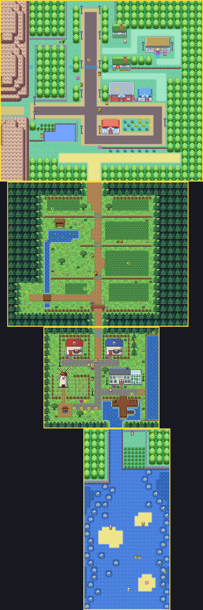

# The world as maps are rebuilt

Towns and routes are rebuilt one by one from the kit (`kit/`). They may grow or shrink, and every map they join
has to keep lining up with them. This page tracks that: each rebuilt map's size, where its roads meet its
neighbours', and what else depends on its shape. Update it with every map.

(From the top: Viridian City, Route 1 and Pallet Town are rebuilt; Route 21 North is still the old map. Make the
picture again with `pae map render` for each map, placed by the offsets below.)

## Rebuilt maps

| Map | Size (blocks) | Was | Tilesets | Joins |
|---|---|---|---|---|
| Pallet Town | 32×28 | 24×20 | kit + `gTileset_PalletConcept` | up: Route 1 (offset −10), down: Route 21 North (offset 11) |
| Route 1 | 50×40 | 50×40 | kit + `gTileset_Route1Concept` | up: Viridian City (offset −2), down: Pallet Town (offset 10) |
| Viridian City | 60×52 | 56×50 | kit + `gTileset_ViridianConcept` | up: Route 2 (offset 16), left: Route 22 (offset 22), down: Route 1 (offset 2) |
| Route 22 | 52×28 | 52×28 | kit + `gTileset_Route22Concept` | right: Viridian City (offset −22); not joined to Route 23 (below) |
| Route 2 | 30×80 | 30×80 | kit + `gTileset_Route2Concept` | up: Pewter City (offset −14), down: Viridian City (offset −16) |

## Where the roads meet

A join lines up one column (or row) of each map, `pae map connect A up B --align a,b`. The roads have to meet:

| Join | Columns | Notes |
|---|---|---|
| Pallet ↔ Route 1 | Pallet 14–15 = Route 1 24–25 | Pallet's road north; Route 1's road under its arch |
| Route 1 ↔ Viridian | Route 1 22–25 = Viridian 24–27 | Route 1's road widens to meet Viridian's |
| Pallet ↔ Route 21 North | Pallet 18–21 = Route 21 7–10 | the water channel south (surf) |
| Viridian ↔ Route 2 | Viridian 22–27 = Route 2 6–11 | Viridian's one-block road north (the old man's) widens at the edge to meet Route 2's path |
| Viridian ↔ Route 22 | Viridian rows 28–31 = Route 22 rows 6–9 | the road west |
| Route 2 ↔ Pewter | Route 2 8–11 = Pewter 22–25 | the road north into Pewter's (Pewter isn't rebuilt) |

When a map changes size, keep these columns where they meet (move the map's road, or change the offset), and if a
map grows to the left or top, its neighbours' offsets change with it.

## Seams

Maps on different tilesets need connection seams (`pae seam build`) so each shows its neighbour's edge right.

| Map | Shows across its edges | How |
|---|---|---|
| Pallet Town | Route 1, Route 21 North | pae |
| Route 1 | Pallet Town, Viridian City | pae |
| Viridian City | Route 1, Route 2, Route 22 | pae (its hand-made seam for the old Viridian is gone) |
| Route 2 | Viridian City, Pewter City | pae |
| Pewter City | Route 2 | pae |
| Route 21 North | Pallet Town | pae |
| Route 22 | Viridian City | pae (both from the kit: only each other's own tiles); its hand-made seam is gone |
| Route 23 | Indigo Plateau | hand-made (its pieces for the old Route 22 are gone) |

Maps built from the kit share the primary tileset, so between them the seams only copy secondary tiles. When both
neighbours are rebuilt from the kit with the same secondary tileset, the seam isn't needed at all.

A seam needs a palette slot in the viewing map for every palette of the strip it shows (the 7 rows or columns
beside the join) that the viewing map doesn't have. Old maps have few free: Viridian's hand-made seam for Route 22
leaves it three. So near a join with a map that isn't rebuilt yet, keep pieces with palettes of their own out of
those 7 rows: Route 1's tall grass (bank 4) starts at row 7. Between maps from the kit, the seams use each other's
palettes and need no slots. A strip of an old map takes slots: its tiles are copied, so pae packs their colours into
as few slots as they fit. Old Pewter's strip uses three of its palettes (23 colours), and it takes two slots of
Route 2 (11–12, the two Route 2 keeps free for it).

**Route 23 isn't joined to Route 22.** The join was only seen across Route 22's top (both edges are solid: you go
through the League gate), and Route 23's strip needs seven palettes, more than Route 22 has free. So each shows its
own border there. Join them again (`pae map connect Route22_Frlg up Route23_Frlg --offset 0`) when Route 23 is
rebuilt from the kit.

## Planned

- **Pallet's sea → Cinnabar.** The sea east of Pallet will lead to Cinnabar Island (the old Route 21 ran south of
  Pallet), so it becomes surfable then: the kit's sea is solid for now (scenery under the cliff), and its rocks stay
  solid. That needs a join off Pallet's east edge (or the sea to meet Route 21's water) and the sea's surf rules
  checked in game (surfing off the cliff top, into a rock).

## What else depends on a map's shape

Check these whenever a map is rebuilt, moved or resized:

- **Events**: people, signs, warps, triggers (`pae map place`); cutscene walks (`pae map path`).
- **Scripts with coordinates**: `setobjectxyperm`, `opendoor`/`closedoor`, `setmetatile`.
- **Heal location** (`src/data/heal_locations.json`), where you wake up after blacking out or flying in.
- **Warps into the map** from its houses, and from other maps that lead to it, such as New Bark's warp to Pallet.
- **Special scenes placed by coordinates**, such as the Friends camp in `src/data/friends_scene_locations.h`.
- **The town map** (`pae world region`): a much bigger town may need a bigger rectangle, and its fly spot.
- **Replay tests** that start or end on the map (`pae test run`).
- **Wild encounters** are per map, not per tile: the grass you draw is where they happen.

## Log

- Pallet Town rebuilt larger: 32×28 instead of 24×20. Its joins were re-aligned to Route 1's road and Route 21's
  water, and the heal spot, Friends camp and New Bark warp moved.
- Route 1 rebuilt at the same size, so Viridian's and Pallet's joins didn't change. Viridian got a pae seam for
  Route 1 beside its hand-made one for Route 22.
- Viridian City rebuilt larger: 60×52 instead of 56×50 (four columns east, two rows south). Its exits kept their
  columns and rows, so no join's offset changed; Route 1 now enters it at row 51. Its heal spot, the Friends camp and
  Route 2's copy of its old tree to cut moved or went; its hand-made seam went too.
- Route 22 rebuilt at the same size, so Viridian's join didn't change; now both are from the kit, they show each other
  (Route 22's strip was missing while it was the old map). Its hand-made seam and Route 23's pieces for it went; it's
  no longer joined to Route 23 (above).
- Route 22's cliffs redone from a rock and cliff pack (tops in nine phases, two-block faces, stairs, rocks): its
  forecourt's edge is a face with stairs now, the rest of the route (and its joins) as it was.
- The kit's trees are the Sunlit Broadleaf pack's (broadleaf trees instead of pines) on every kit map. The forest
  keeps its cells, so no map's layout, walls or joins changed.
- Route 2 rebuilt at the same size, so Viridian's and Pewter's joins didn't change. Its warps (the forest's gates,
  the east building, the trade house, Diglett's Cave), the trees to cut (three now), items, signs and the Friends
  camp moved; the camp's anchor and first local id in `src/data/friends_scene_locations.h` changed with it. Pewter
  got a pae seam for it. The kit reserves tiles 434–449 for doors now (double doors' frames), and gained three
  forest corners.
