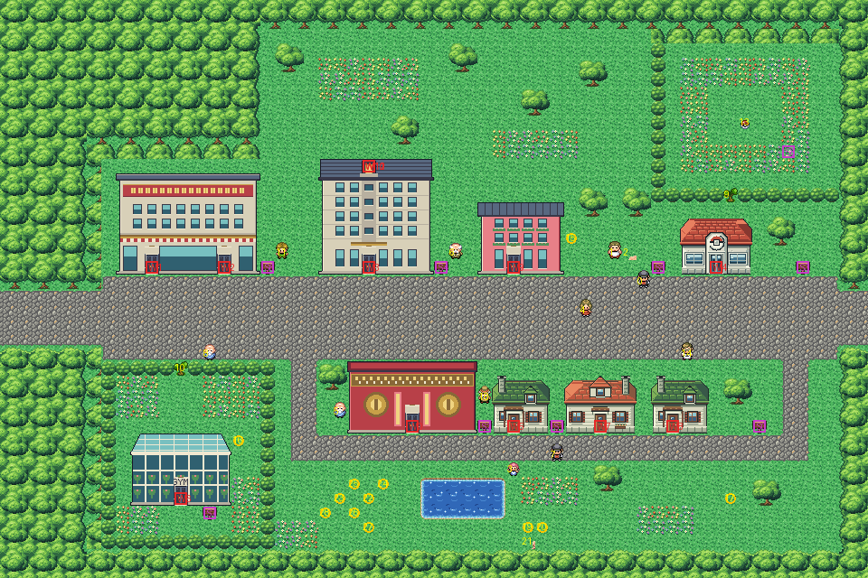

# Celadon City after its concept

Kanto's garden city, the city of rainbow dreams, rebuilt from the kit (`../kit`). The concept is this folder's own:
`draw_plan.py` draws the block plan (`plan_stage1.txt`) from shapes and says why things are where they are.

The city is 60×40 blocks, as old Celadon was. Its boulevard (rows 20–23) runs right through it: Route 16's road (its
rows 22–25) meets it at the left edge (offset −2; −5 with old Route 16) and Route 7's (its rows 10–13) at the right (offset 10, was
8). It has:
- **the boulevard**, four lanes of asphalt with a dashed line down the middle, kerbed pavements either side, two
  zebra crossings where Lucky Lane meets it, manholes and lamps, and the routes' cobble at its two ends (KR-91), with
  the town sign by the east entrance;
- **the Department Store** on its north side, its two doors onto the pavement and its sign;
- **the Celadon Mansion** beside it, with its back door onto the lawn behind it, reached up the path beside the
  Mansion (a doorway: you walk south onto it and south again, and the game walks you one step in). The softboiled
  tutor stands on its east side;
- **the hotel** and **the Pokémon Center** further east, with the fat man and his Poliwrath between them. Behind the
  Center is **a walled garden**, closed by a tree to cut, with the Ether and a hidden PP Up in it;
- **Lucky Lane** south of the boulevard, a brick shopping street with a compass set in it before the Game Corner,
  with the Game Corner, its Prize Room, the restaurant and a house along it, and their signs by their doors;
- **Erika's Gym** in the south-west: a glasshouse in a hedged flower garden behind the second tree to cut, Bellsprout
  in its beds;
- **the pond garden** south of Lucky Lane, where the little girl walks round the flowers and Jigglypuff sits. The
  Friends camp here once the Rocket Hideout is cleared (round 25,34), and so do the researchers with their Meowth.

Every warp keeps its number. The Mansion's back door is warps 10–12 on one block (the Mansion points at 11). The
people keep their order, since the stranger's and the researchers' scenes remove them by local id; all of them
moved. Other fixed spots moved too:
- the heal spot moved with the Center (49,19, `src/data/heal_locations.json`);
- the Friends' camp moved to `src/data/friends_scene_locations.h`'s 25,34;
- the credits' view moved onto the boulevard (49,21, `src/credits_frlg.c`).

Route 16's tree is still shown across the join where it stands on Route 16's grid (the clone, now at −10,19). Route
7's clone of the town's border tree moved with its join (−10,3).

The pieces:
- the kit's ground, plants, Pokémon Center, lamps and streets (the asphalt, its line, the crossings, the manholes,
  the asphalt's join to the cobble);
- Celadon's own pavements (`make_art.py` `walk()`): the kit's pavement with the lawn under its edges on one side and
  the asphalt under its kerb on the road's, as one row of pavement between a lawn and the road needs;
- Kanto Street Textures v0.3's brick and compass (Part B, `../packs/streets_v0.3/`) in the pack's city palette
  (bank 10). Only the pieces the map shows are drawn (`autotiled()`), so they take 32 tiles;
- five buildings from Kanto Buildings Remakes v0.3 (`../packs/buildings_v0.3/`), in one palette (bank 9): the Department Store, the
  Mansion, the hotel, the Game Corner and Erika's glasshouse Gym, each with its own door frames;
- Viridian's houses in their palette (bank 7): the pond keeper's for the Prize Room and the house, the family's for
  the restaurant.

The town's own tileset holds 384 tiles. The first stand-ins came to 428, so buildings here are drawn on the 16-pixel
grid (their tiles repeat) and two houses share a pack (KR-8). See `../ASSETS.md` for every pack and
how to replace one.

The seams are pae's:
- with Route 7, both maps are the kit's (KR-54 went with old Celadon);
- with Route 16, both maps are the kit's too (with old Route 16, its palettes took banks 10–11 here).

The west seven columns are forest and road only, as old Route 16 needed. Old Celadon had no
hand-made seam.

`make_art.py` checks the city's rules on the map it builds:
- only the boulevard's two ends open onto the edges;
- the west seven columns are forest and road only;
- the trees close the walled garden and the Gym garden, and stand more than 8 blocks from either edge (KR-45);
- with them cut, everything walkable is reached;
- every door can be walked into (the Mansion's back door from above) and every sign read;
- the Friends' camp is open ground and the little girl's walk is clear.

Build it from the repository root with `sh project/art/celadon-concept/build.sh` (or every map with
`sh project/art/build_all.sh`).

Its Town Props (KR-94, `../kit/props.py`): a bench looking at the north park's flower bed and a bin. They fill the tileset: 384 of 384 tiles.
