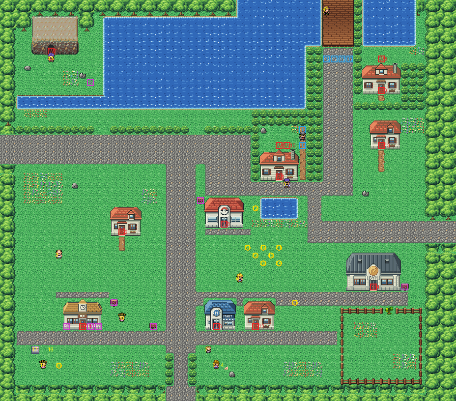

# Cerulean City after its concept

The town by the lake where Nugget Bridge comes down, rebuilt from the kit (`../kit`), the kit's Center and Mart,
Viridian's buildings and Route 2's cave mouth. The concept is this folder's own: `draw_plan.py` draws the block plan
(`plan_stage1.txt`) from shapes and says why things are where they are.

The town is 58×51 blocks, as before, and its four exits stay where its neighbours meet it: Nugget Bridge (Route 24)
the top at columns 41–44, Route 4's road the left edge at rows 17–20, Route 9's the right edge at rows 28–30, Route 5's
the bottom at columns 21–24. It has:
- **the bridge road** down from Nugget Bridge, where Blue waits (his scene walks the same columns as before, and his
  triggers stay across it at row 7);
- **the lake** west of the bridge, and **Cerulean Cave** on its island, reached only by surfing, its guard at the mouth;
- **the badge house** east of the bridge road, with its back door onto a yard you reach only through the house, and
  the berry man's house below it;
- **the robbed house** in the middle of town, with the thieves' hole into its backyard and the Rocket in the
  one-block way out of it, his triggers either side of him; the policeman at its door;
- the Pokémon Center (heal spot 28,29) by the plaza's pool, the Friends' camp (their fourth scene: anchor 34,32), the
  Gym south of the road east, the Mart, the Bike Shop (Viridian's Trainer School) and three small houses, the
  Pokémon shelter's corner, and a garden behind a tree to cut;
- **the neck** on the road south (22–23,45), where the lass and her Slowbro stand until you have the S.S. Ticket
  (`CeruleanCity_EventScript_BlockExits` puts them there); after it they stand south of the Mart.

Every warp keeps its number and the people their order. The Bike Shop's three warps are one door; the hole and the
back door are lawn you step on and walk south from into the house (they aren't drawn yet).

Its tileset's palettes: bank 7 the Gym and the Bike Shop, bank 9 the houses and the cave mouth (drawn in the houses'
palette, the two colours they don't use being the cave's), bank 8 the kit's plants. 10–12 and the primary's unused
bank 4 hold the seams to Routes 5, 9 and 24, which aren't rebuilt yet; Route 5's strip is drawn a little off in
colour (one of its palettes in its nearest colours) until it is.

`make_art.py` checks the town's rules on the map it builds: only the four exits open onto the edges; with the tree
standing, the Rocket and his triggers in his way and the lass and her Slowbro in the neck, the town is everything but
the garden, the backyard, the yard, the island and the road south past the neck; each of those opens only its own way
(the tree, the Rocket, the house, Surf, the S.S. Ticket); every door and sign can be reached.

Build it from the repository root with `sh project/art/cerulean-concept/build.sh` (or every map with
`sh project/art/build_all.sh`).
