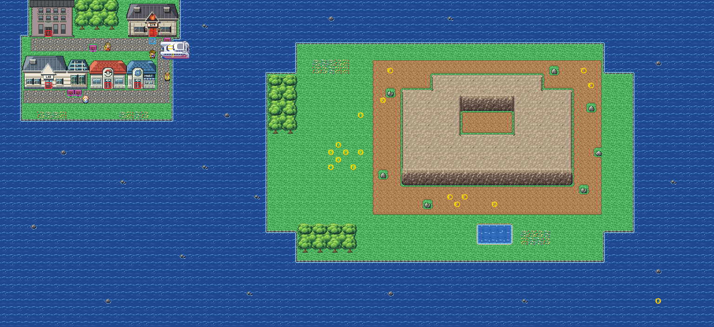

# Cinnabar Island after its concept

Kanto's volcanic island town, out in the southern sea. It is rebuilt from the kit (`../kit`). The concept is this
folder's own: `draw_plan.py` draws the block plan (`plan_stage1.txt`) from shapes and says why things are where they
are.

The island is 96×44 blocks, as before. Its joins stay where they were:
- Route 21's sea is above (its columns 0–23, offset 0): its foot is the woods behind the town, and the sea lane down
  the town's west side;
- Route 20's sea is to the right (its rows 0–19, offset 0).

It has two islands:
- **the town island** at the top left: the burned Pokémon Mansion and Blaine's Gym backing onto the woods along the
  north shore, the street between them; the Pokémon Lab, the Pokémon Center and the Mart along the harbour street
  below; the east lane down to the harbour, where the Seagallop comes in; the beach along the south;
- **the volcano island** to the east, across the harbour: the volcano's rock in the middle, narrower at its summit,
  its crater a pit of ash in its top (no way down into it), its slopes of ash and boulders round it with its Pokémon (Magmar and Magby, Magcargo and Slugma, Torkoal, Koffing and Weezing), a hot
  spring below it, the woods and lawns where the Friends camp (round 46,20, Giratina's rift four blocks west).

The doors the island's scenes walk to stay where they were: the Center's at 14,11 (Bill goes back in through it) and
the Gym's at 20,4 (its lock at 20,5). Bill and the player still walk the harbour street (row 12) and the east lane
(column 21) to the boat, which comes in from the east on rows 8 and 12. The Mansion's, the Lab's and the Mart's doors
moved (6,4; 6,11; 18,11); every warp keeps its number, so the buildings behind them still point at it.

The pieces: the kit's and its Pokémon Center and Mart; the island's own buildings, each in its own palette: Blaine's
Gym and the Pokémon Lab (Oak's, as Pallet has it) from Kanto Buildings Remakes v0.3 (`../packs/buildings_v0.3/`); the burned Mansion
(`buildings/pokemon_mansion`: Celadon's old hotel, greyed, darkened and streaked with soot, until the remakes' larger
Mansion moves in); the kit's cliffs for the volcano's rock.

It was rebuilt with Route 21, in one pull request, so that every join between them is between kit maps. Old
Route 20 still needs a seam (KR-78). The old island's layout was in FireRed's metatile format, so its build sets the
kit's (HnS's, `--version hns`: KR-74).

`make_art.py` checks the island's rules on the map it builds:
- on foot the town is one place, reached from its street; the only walkable block on an edge is the lawn between the
  woods and the Gym, under Route 21's woods;
- by Surf from Route 21's lane, both islands and Route 20's sea are reached; the islands aren't joined on foot;
- every door can be walked into and every sign read; the Center's and the Gym's doors are where the scenes need them;
- the scenes' ground is open and the boat's way is open sea;
- the Friends' camp and Giratina's spot are open ground; the people and Pokémon stand on open ground, Wailmer swims;
- the volcano's crater is a closed pit.

Build it from the repository root with `sh project/art/cinnabar-concept/build.sh` (or every map with
`sh project/art/build_all.sh`).
