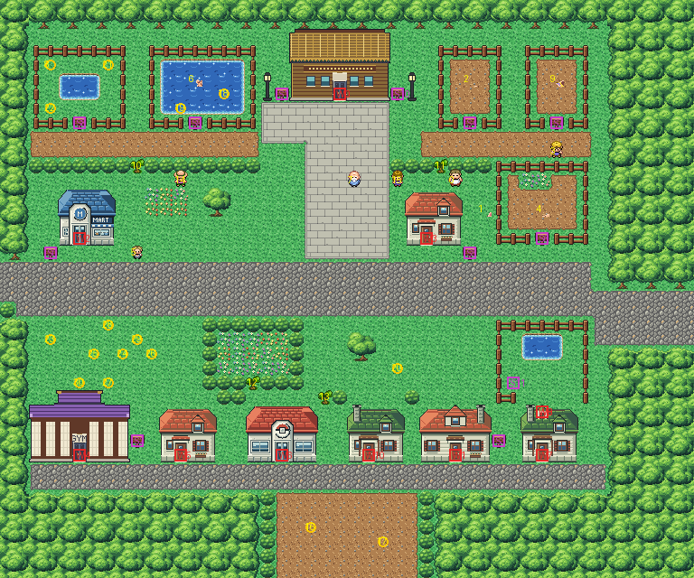

# Fuchsia City after its concept

Kanto's town of the Safari Zone, by the southern sea, rebuilt from the kit (`../kit`). The concept is this folder's
own: `draw_plan.py` draws the block plan (`plan_stage1.txt`) from shapes and says why things are where they are.

The town is 48×40 blocks, as before, and its joins stay where they were:
- Route 18's road (its rows 8–10) meets the left edge at rows 18–20 (offset 10);
- Route 15's road (its rows 4–7) meets the right edge at rows 20–23 (offset 16; it was 15 before Route 15 was rebuilt);
- Route 19's beach path (its columns 7–16) runs on below the bottom edge from columns 19–28 (offset 12).

It has:
- **the Safari plaza** at the top, under the woods: the Safari Zone's gate lodge, the Safari Zone's sign and the
  Safari Game's notice.
- **the zoo** either side of the plaza: the pens of Pokémon from the Safari Zone, along two walks, each with its sign.
  - To the west: the fossil Pokémon's pond (Kabuto or Omanyte, by the fossil you chose, and two Omanyte) and Lapras's
    lake (with two Dratini).
  - To the east: Voltorb's, Kangaskhan's and Chansey's yards.
  - The pens are closed: their Pokémon stay in.
- **the main street** across the town, from Route 18 to Route 15. The avenue from the plaza meets it. The Mart and
  the Safari Zone's office stand along it, with Slowpoke dozing in the office's garden.
- **the park** south of the main street, with the Friends' camp on its lawn and a flower garden behind a hedge.
- **the shore street** along the south. Koga's Gym, two houses, the Pokémon Center, the Warden's house and the house
  with the pond garden stand along it. The pond garden behind that house is reached only by its back door, and the
  Max Revive is hidden in it.
- **the beach path** down from the shore street to Route 19's beach, through the woods. Two Kabuto are on it.

Trees to cut close four short ways:
- the zoo's west walk to the main street (9,11);
- the east walk to the office's garden (30,11);
- the park's flower garden (17,26), the one place only a tree closes;
- the lane by the Center (22,27).

## The buildings

Drawn here (`fuchsia_buildings.py`):
- **the Safari Zone's gate lodge**, in Saffron's buildings' palette (bank 9): a lodge under a deep thatched roof,
  with a gold-lettered signboard and log walls;
- **Koga's Gym**, in the same palette: a ninja house with a violet roof in two tiers, dark timber and paper screens,
  and the Gym's board over its door;
- **the house with the pond garden**: Viridian's pond keeper's house with a dormer door added in its roof's back
  slope, beside the chimney (bank 7). The door is entered walking south from the garden, and doesn't animate.

The Safari Zone's office and a house are Viridian's gardener's house, the Warden's is the family's, and the other
house is the pond keeper's (all bank 7). The Center and the Mart are the kit's.

## Events

Every warp keeps its number:

| Warp | Where | Block |
|---|---|---|
| 0 | the lodge | 23,6 |
| 1 | the Warden's house | 31,31 |
| 2 | the Mart | 5,16 |
| 3 | the office | 29,16 |
| 4 | the Gym | 5,31 |
| 5 | a house | 12,31 |
| 6 | the Center | 19,31 |
| 7 | the pond-garden house's front door | 37,31 |
| 8, 9 | its back door (one block; the house points at 8) | 37,28 |
| 10 | a house | 25,31 |

The people and Pokémon keep their order, and all of them moved.

Other places that depend on the map, all moved:
- the heal spot, in front of the Center: 19,32 (`src/data/heal_locations.json`);
- the Friends' camp: round 8,24, with Brian first (local id 25; `src/data/friends_scene_locations.h`);
- the credits' view of the town: the plaza, 23,10 (`src/credits_frlg.c`).

## Pieces and seams

The pieces are the kit's, the two drawn buildings and Viridian's houses. The town takes 207 of its 384 tiles.

The seams are pae's:
- **Route 18**: both maps are the kit's, so Route 18 needs pieces only for the Gym and the town's own metatiles in its
  view: 37 pieces, 30 tiles.
- **Old Route 19 drawn here**: 17 pieces, 47 tiles, its palettes in banks 10–11 (Route 15 is the kit's since it
  was rebuilt: no seam).
- **This town drawn by old Route 19**: its bottom seven rows (63 pieces). The strips are only forest, lawn, road,
  dirt and hedges.

## The rules

`make_art.py` checks the town's rules on the map it builds:
- only the three roads open onto the edges, and the zoo's pens are closed;
- with the trees cut and the house walked through, everything walkable is reached from the main street;
- without the trees, all of it but the flower garden is reached, and the pond garden only through the house;
- the trees stand more than 8 blocks from the edges you come in by (KR-45);
- every door can be walked into (the back door from the garden), every sign read, and the hidden item found;
- the Friends' camp is open ground;
- the strips the old routes draw are forest, lawn, road, dirt and hedges only.

Build it from the repository root with `sh project/art/fuchsia-concept/build.sh` (or every map with
`sh project/art/build_all.sh`).
