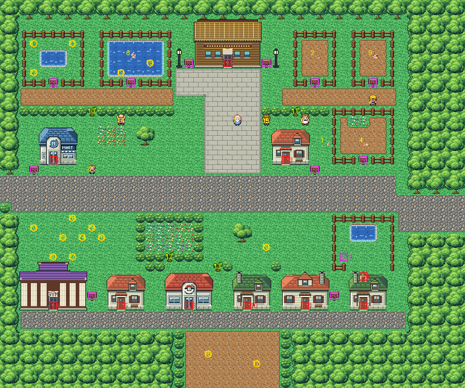

# Fuchsia City after its concept

Kanto's town of the Safari Zone, by the southern sea, rebuilt from the kit (`../kit`). The concept is this folder's
own: `draw_plan.py` draws the block plan (`plan_stage1.txt`) from shapes and says why things are where they are.

The town is 48×40 blocks, as before, and its joins stay where they were:
- Route 18's road (its rows 8–10) meets the left edge at rows 18–20 (offset 10);
- Route 15's road (its rows 4–7) meets the right edge at rows 20–23 (offset 16; it was 15 before Route 15 was rebuilt);
- Route 19's beach path (its columns 7–16) runs on below the bottom edge from columns 19–28 (offset 12); Fuchsia's path is as wide as Route 19's, columns 18–29.

It has:
- **the Safari plaza** at the top, under the woods: the Safari Zone's gate lodge, the Safari Zone's sign and the
  Safari Game's notice.
- **the zoo** either side of the plaza: the pens of Pokémon from the Safari Zone, along two walks, each with its sign.
  - To the west: the fossil Pokémon's pond (Kabuto or Omanyte, by the fossil you chose, and two Omanyte) and Lapras's
    lake (with two Dratini).
  - To the east: Voltorb's, Kangaskhan's and Chansey's yards.
  - The pens are closed: their Pokémon stay in.
- **the main street** across the town, from Route 18 to Route 15. The avenue from the plaza meets it. The Mart and
  the Safari Zone's office stand along it, with Slowpoke dozing in the office's garden.
- **the park** south of the main street, with the Friends' camp on its lawn and a flower garden behind a hedge.
- **the shore street** along the south. Koga's Gym, two houses, the Pokémon Center, the Warden's house and the house
  with the pond garden stand along it. The pond garden behind that house is reached only by its back door, and the
  Max Revive is hidden in it.
- **the beach path** down from the shore street to Route 19's beach, through the woods. Two Kabuto are on it.

Trees to cut close four short ways:
- the zoo's west walk to the main street (9,11);
- the east walk to the office's garden (30,11);
- the park's flower garden (17,26), the one place only a tree closes;
- the lane by the Center (22,27).

## The buildings

From Kanto Buildings Remakes v0.3 (`../packs/buildings_v0.3/`):
- **the Safari Zone's gate lodge**, in Saffron's buildings' palette (bank 9): a thatched gable over log walls, with
  a timber signboard and lanterns;
- **Koga's Gym**, in the same palette: a ninja compound with two layered purple roofs, timber posts and paper
  screens, and the Gym's board over its door;
- **the house with the pond garden**: Viridian's pond keeper's house with a dormer doorway in its roof's back slope
  (bank 7). The back door is entered walking south from the garden, and doesn't animate.

The Safari Zone's office and the two houses on the shore street (by the Gym, and by the Center) are Viridian's
gardener's house, and the Warden's is the family's (all bank 7). The Center and the Mart are the kit's. The house by
the Center was the pond keeper's until the detail pass (KR-99): the town's tileset was nearly full, and sharing the
gardener's made room for the pack (the owner's call, November 3).

## Events

Every warp keeps its number:

| Warp | Where | Block |
|---|---|---|
| 0 | the lodge | 23,6 |
| 1 | the Warden's house | 31,31 |
| 2 | the Mart | 5,16 |
| 3 | the office | 29,16 |
| 4 | the Gym | 5,31 |
| 5 | a house | 12,31 |
| 6 | the Center | 19,31 |
| 7 | the pond-garden house's front door | 37,31 |
| 8, 9 | its back door (one block; the house points at 8) | 37,28 |
| 10 | a house | 25,31 |

The people and Pokémon keep their order, and all of them moved.

Other places that depend on the map, all moved:
- the heal spot, in front of the Center: 19,32 (`src/data/heal_locations.json`);
- the Friends' camp: round 8,24, with Brian first (local id 25; `src/data/friends_scene_locations.h`);
- the credits' view of the town: the plaza, 23,10 (`src/credits_frlg.c`).

## Pieces and seams

The pieces are the kit's, the two drawn buildings, Viridian's houses, the Town Props and the town's own pack (below).

The seams are pae's. Routes 18, 15 and 19 are all the kit's since they were rebuilt, so the town needs no pieces for
them; each of them draws the town's edge with pieces copied into its own tileset (since KR-99, the sandstone, the
palisade and the boards among them): Route 18 48 pieces, 82 tiles; Route 15 14 pieces, 8 tiles; Route 19 3 pieces, 5
tiles.

## The rules

`make_art.py` checks the town's rules on the map it builds:
- only the three roads open onto the edges, and the zoo's pens are closed;
- with the trees cut and the house walked through, everything walkable is reached from the main street;
- without the trees, all of it but the flower garden is reached, and the pond garden only through the house;
- the trees stand more than 8 blocks from the edges you come in by (KR-45);
- every door can be walked into (the back door from the garden), every sign read, and the hidden item found;
- the Friends' camp is open ground;
- the fuchsia bushes make nobody's walk longer: it's as many steps from the main street to every other block with
  them as without them (the story walks up the lanes between the houses).

Build it from the repository root with `sh project/art/fuchsia-concept/build.sh` (or every map with
`sh project/art/build_all.sh`).

Its Town Props (KR-94, `../kit/props.py`): a statue on the Safari Zone plaza's west wing, flower tubs either side of the gate, stone benches along the walk and a bin at its foot, all on the sandstone (since KR-99), and a picnic table in the park east of the tree.

The main street keeps Route 18's three rows for four blocks into town (polish, round three).

## Its own look (KR-99)

Kanto Fuchsia City v0.1 (`../packs/fuchsia_v0.1`, made with another AI from `Fuchsia_City_v0.1_prompt.md`), laid by
`../kit/fuchsia.py`:
- **sandstone** through the whole town: both streets, the Safari plaza, its avenue and the zoo's two walks (the plan's
  cobble, paving and the dirt of rows 9–10), its 32x32 pattern anchored to the map. It has the same edge wherever it
  meets the lawn, and runs straight up to the lodge's front. At the west and east edges each street block's outer half
  is the pack's join to the cobble, so Route 18's and Route 15's cobble roads run into it; below the shore street the
  join to the dirt opens onto the beach path, whose top row runs on from it without a lawn lip. The Town Props on it
  stand on its block there.
- **a bamboo palisade** for every fence: the five pens and the pond garden (picked by its neighbours: it ends in a
  post beside a board or a wall).
- **an exhibit board** in each pen's fence line, where the kit's signs were (the signs' events are where they were).
- **13 fuchsia bushes** (solid) along the back of the two flower beds west of the avenue and of the park's flower
  garden, beside the Mart and the office, and beside the house at the shore street's east end; none in the lanes up
  between the houses (`make_art.py`: `BOARDS`, `BUSHES`).

The sandstone has a palette of its own (bank 10: the kit's ground palette with its darkest colour swapped for the
stone's, so its edges and joins keep the kit's lawn, dirt and cobble exactly); the palisade and the boards are in the
lodge's (bank 9), the bushes in the kit's plants. The town takes 372 of its 384 tiles (all 29 of the pack's), 182
metatiles. The pack's optional fuchsia street lamp wasn't made.
