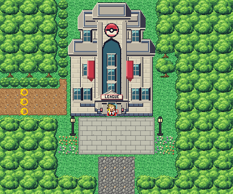

# Indigo Plateau after its concept

The Pokémon League's mountaintop. It is rebuilt from the kit (`../kit`). The concept is this folder's own:
`draw_plan.py` draws the block plan (`plan_stage1.txt`) from shapes and says why things are where they are.

The mountaintop is 24×20 blocks, as before. Its joins stay where they were:
- Route 23's road (its columns 10–13) leaves the bottom edge at columns 10–13 (offset 0);
- League West Pass's road (its rows 9–11) meets the left edge at rows 9–11 (offset 0). League West Pass is still the
  old map: each draws the other's strip from a pae seam.

It has:
- **the League's tower** at the top, its door at 11,11 (warp 0, into the Pokémon Center, as before; it was at 11,6);
- **the forecourt** before it, paved, lamps and flower beds either side, a tree by the tower;
- **the road** down from the forecourt to Route 23, cobbled, between the pines;
- **the west road** out to League West Pass (and Johto), under construction: the three workers stand across it until
  the game is won, as before.

The warp keeps its number; the people keep their order (the credits' rival and Oak stand at the door, hidden till
then, as before). The Pokémon League is from Kanto Buildings Remakes v0.3 (`../packs/buildings_v0.3/`): a
grand limestone hall with roof terraces, crimson banners and a Poké Ball relief, in its own palette (bank 7). The old mountaintop's layout was in
FireRed's metatile format; its build sets the kit's.

`make_art.py` checks the mountaintop's rules on the map it builds:
- only Route 23's road and League West Pass's open onto the edges;
- everything walkable is reached from Route 23's road; the League's door can be walked into;
- the workers close the west road: with them there League West Pass isn't reached.

Build it from the repository root with `sh project/art/indigo-concept/build.sh` (or every map with
`sh project/art/build_all.sh`).
