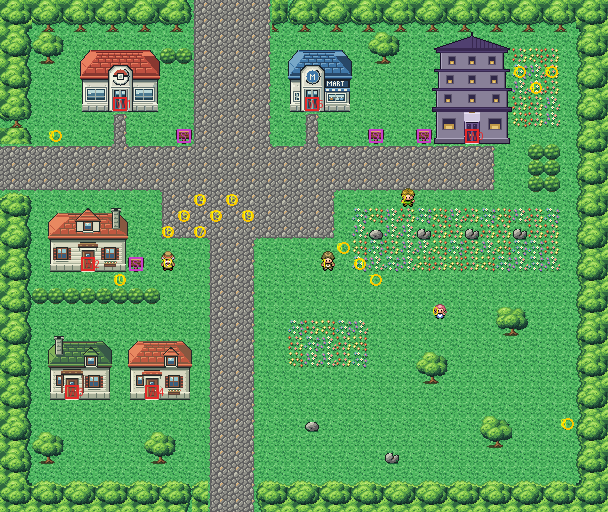

# Lavender Town after its concept

The quiet town in a hollow of the hills, where people come to remember their Pokémon, rebuilt from the kit (`../kit`).
The concept is this folder's own: `draw_plan.py` draws the block plan (`plan_stage1.txt`) from shapes and says why
things are where they are.

The town is 38×32 blocks (old Lavender was 38×31), as wide as before. Route 10's road meets the top at columns 12–16
and Route 8's the left edge at rows 9–11, where they met the old town. Route 12's road meets the bottom at columns
13–15, under the square: Route 12 moves 4 blocks east under the town to meet it (its join's offset is 2, was −2;
KR-50). It has:
- **the square**, where the three roads meet: the Pokémon Center and the Poké Mart on its north side either side of
  the road from Route 10, the town sign, and the Friends' camp (round 13,13, as before);
- **Pokémon Tower** at the east end of the street, the tallest building in the east of Kanto, with its sign and the
  Silph Scope notice on the way up to it and a garden of flowers by it. It is drawn here (`buildings/pokemon_tower`,
  written by `make_art.py`): three storeys of violet stone with candles in the windows, a violet roof, and Pewter
  Gym's door frames recoloured with the board over the door left blank;
- **the stone garden** south of the street, flowers with four grave stones, where the worker stands and the Haunters
  go round at night;
- **Mr. Fuji's Volunteer Pokémon House** west of the square with its sign (the stranger waits by it once you have the
  Poké Flute), and two houses in the south-west yard (the Name Rater's the east one);
- **the road south** to Route 12, between lawns and the town's few trees.

Every warp keeps its number and the people keep their order (the stranger's scene removes him by local id). The heal
spot moved with the Center (7,7, `src/data/heal_locations.json`, its old-map override dropped). The pieces are the
kit's, the Pokémon Center and the Mart (the kit's), Viridian's three houses in their palette (bank 7) and the tower in
its own (bank 9). The seams are pae's: with Route 10 both maps are the kit's; old Route 8's and old Route 12's colours
fit in banks 10–12.

`make_art.py` checks the town's rules on the map it builds:
- only its three roads open onto the edges;
- everything walkable is reached from Route 10's road;
- every door can be walked into from the block below it, every sign read from it;
- the Friends' camp is open ground.

Build it from the repository root with `sh project/art/lavender-concept/build.sh` (or every map with
`sh project/art/build_all.sh`).
