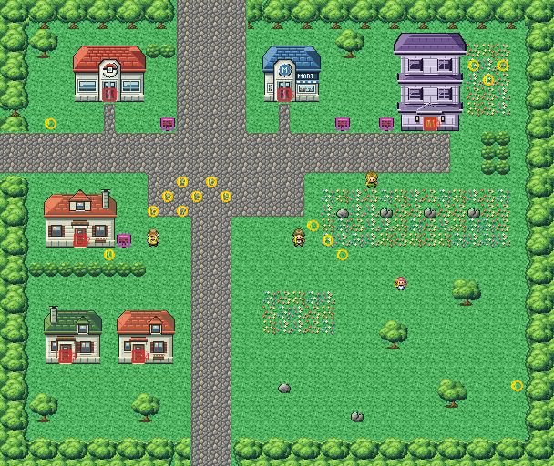

# Lavender Town after its concept

The quiet town in a hollow of the hills, where people come to remember their Pokémon, rebuilt from the kit (`../kit`).
The concept is this folder's own: `draw_plan.py` draws the block plan (`plan_stage1.txt`) from shapes and says why
things are where they are.

The town is 38×32 blocks (old Lavender was 38×31), as wide as before. Route 10's road meets the top at columns 12–16,
where it met the old town, and Route 8's the left edge at rows 9–11 (the new Route 8's rows 13–15, offset −4). Route
12's road meets the bottom at columns 12–15 (as wide as Route 12's), under the square: Route 12 moves 4 blocks east under the town to meet it
(its join's offset is 2, was −2; KR-50). It has:
- **the square**, where the three roads meet: the Pokémon Center and the Poké Mart on its north side either side of
  the road from Route 10, the town sign, and the Friends' camp (round 13,13, as before);
- **Pokémon Tower** at the east end of the street, the tallest building in the east of Kanto, with its sign and the
  Silph Scope notice on the way up to it and a garden of flowers by it. It is from Kanto Buildings Remakes v0.3 (`../packs/buildings_v0.3/`): a solemn lavender memorial tower with three layered roofs, quiet stone
  courses, narrow recessed windows and a dark framed entrance;
- **the stone garden** south of the street, flowers with four grave stones, where the worker stands and the Haunters
  go round at night;
- **Mr. Fuji's Volunteer Pokémon House** west of the square with its sign (the stranger waits by it once you have the
  Poké Flute), and two houses in the south-west yard (the Name Rater's the east one);
- **the road south** to Route 12, between lawns and the town's few trees.

Every warp keeps its number and the people keep their order (the stranger's scene removes him by local id). The heal
spot moved with the Center (7,7, `src/data/heal_locations.json`, its old-map override dropped). The pieces are the
kit's, the Pokémon Center and the Mart (the kit's), Viridian's three houses in their palette (bank 7) and the tower in
its own (bank 9). The seams are pae's: with Routes 10 and 8 both maps are the kit's; old Route 12's colours fit in banks
10–12.

`make_art.py` checks the town's rules on the map it builds:
- only its three roads open onto the edges;
- everything walkable is reached from Route 10's road;
- every door can be walked into from the block below it, every sign read from it;
- the Friends' camp is open ground.

Build it from the repository root with `sh project/art/lavender-concept/build.sh` (or every map with
`sh project/art/build_all.sh`).

Its Town Props (KR-94, `../kit/props.py`): a Pokémon statue between the Mart and the Tower, two benches looking at the
memorial garden, a bin by the road.

Its own look (KR-98) is Kanto Lavender Town v0.1 (`../packs/lavender_v0.1`, made with another AI from
`Lavender_Town_v0.1_prompt.md`), laid by `../kit/lavender.py`. The town is slate (σ in the plan): the square, the walk
to the Tower, the paths to the Center and the Mart and the three roads to the map's edges, where each edge block's outer
half is the pack's join to the cobble, so the routes' roads run into it. The garden of remembrance runs from the walk to
the town's south edge: lavender rows (λ), a gravel path (γ) down the middle from an open gate between two stone
lanterns to a stone between two more at the forest's edge, three paths across, 14 memorial stones and 3 offering stones,
two trees, the benches either side of the path (the gravel draws no edge, so it runs into the lavender, the lawn and
the trees alike); a low iron railing along the walk and down the garden's west side from
row 18 (open where its paths come out, and north of that for the Haunters' rounds). Lavender beside the Tower and on the
south lawn; two violet street lamps by the road south; Mr. Fuji's yard: the rest shelter, the bowls and a straw bed. The
railings, the gate and the details are listed in `make_art.py` (`RAILS`, `GATES`, `DETAILS`; the routes' roads past
the edges in `EDGE_ROADS`). The slate, gravel and lavender have a palette of their own (bank 10). 289 of its 384 tiles.
