# Pallet Town after the concept art

The second proof of concept for maps made from scratch (the first was `pallet-from-scratch` on the
`claude/pallet-from-scratch` branch). `concept.png` was made with image generation. This folder rebuilds that town in
the game, larger (32×28 blocks, the original is 24×20) and with every tile drawn by `make_art.py`. Only the character
sprites, Pokémon and story come from the game.

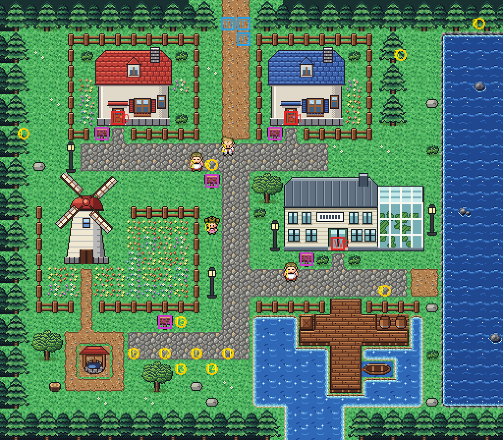

## Rebuild

From the repository root: `sh project/art/build_all.sh` (every map made from the kit: the kit's primary tileset is
shared, so a change to it means building them all), or `sh project/art/pallet-concept/build.sh` for this one. It
runs:

1. `make_art.py`: the kit's pieces (`../kit`: grass, paths, water, fences, the forest and the rest every map shares;
   the lawn is a native pixel pack, `../kit/lawn/B_Lush_Emerald/`, four tiles and one with daisies, scattered)
   and the town's own (`houses.py` for your house and your rival's, the windmill, Oak's lab); writes `sheets/`, the
   town's palettes, `spec.json`, `grid.txt`, `legend.json`.
2. `pae tileset new` (the first time) and `pae map geometry`: two new tilesets and the map's block files.
3. `pae tileset build` and `pae map paint`. The water is animated in eight frames. The pond and the channel come from
   a native pixel pack (`../kit/pond/`): gentle ripples, an earth bank and inside corners, with three kinds of open
   water so it doesn't repeat every block. The sea comes from a second pack (`../kit/sea/`): broad swells, a rocky
   cliff with surf at its foot, and sea rocks (`q` and `Q` in the grid, three of them off the cliff).
4. `pae map connect`: the road north meets Route 1's, and the channel south meets Route 21's water.
5. `pae seam build` and `pae door add`: the edge strips across tilesets, and the three door animations (each house's and the lab's).
6. `pae map place`: the events.
7. `pae map path`: Oak's walks to and into the lab.

A few coordinates in scripts were changed by hand:

- the lab door in `opendoor`/`closedoor`;
- the `setobjectxyperm` positions of Oak and the sign lady;
- Pallet's heal spot in `src/data/heal_locations.json`;
- the Friends camp in `src/data/friends_scene_locations.h`;
- New Bark's warp back to Pallet.

## In game

The game's time of day tints these screenshots.

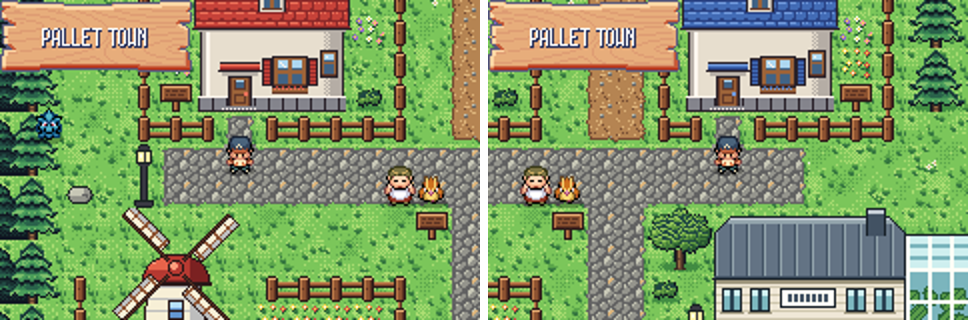
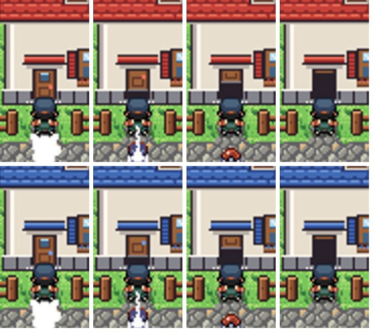
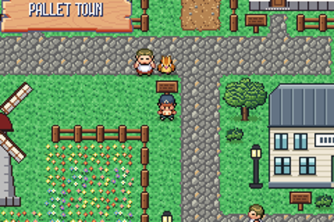
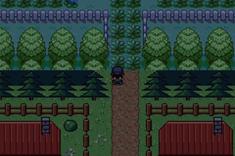
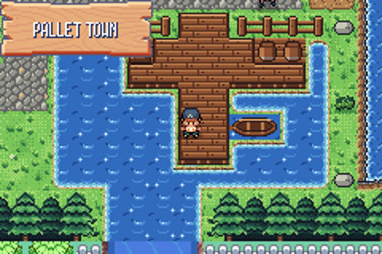
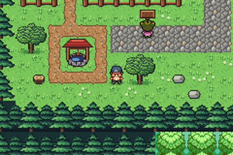
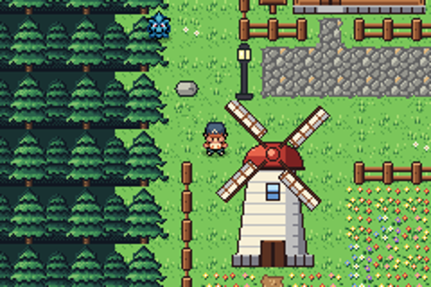
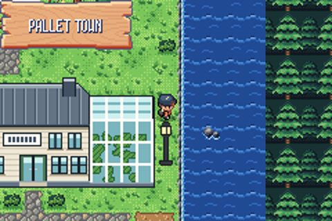
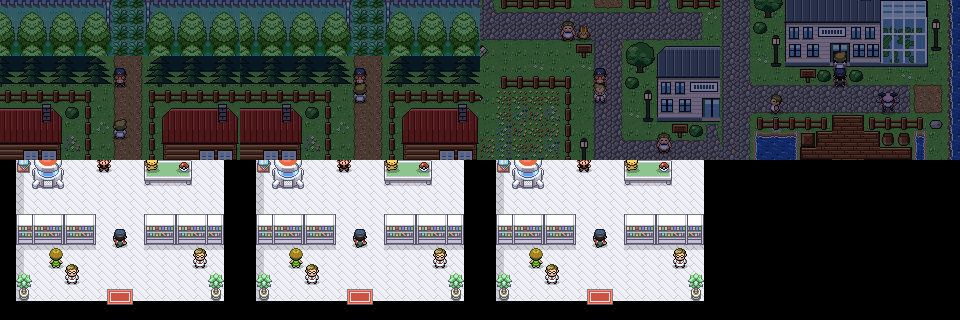
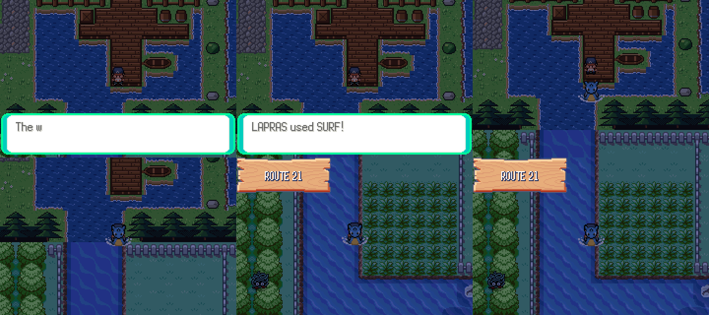

Replay tests: `pallet looks at the sea`, `pallet north to route 1`, `pallet route 1 looks at pallet`,
`pallet house door`, `pallet rival house door`,
`pallet house sign`, `pallet rival house sign`,
`pallet lab door`, `pallet oak stops you`, `pallet surf to route 21`.
