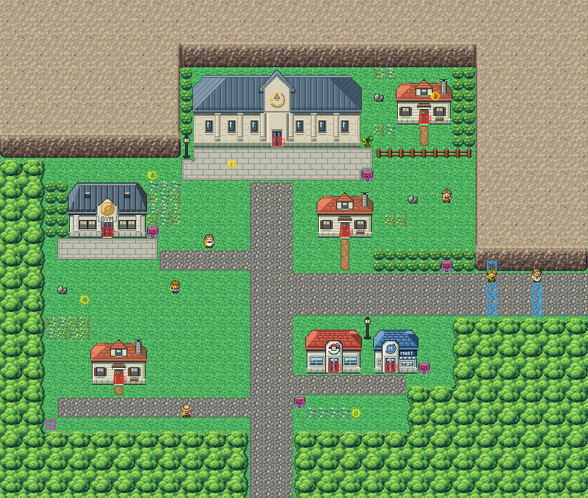

# Pewter City after its concept

The grey-stone town at the foot of the mountains, rebuilt from the kit (`../kit`), its cliffs and the buildings of the
towns before. The concept is this folder's own: `draw_plan.py` draws the block plan (`plan_stage1.txt`) from shapes,
and says why each thing is where it is.

The town is 52×44 blocks, as before, and its exits stay where its neighbours meet it: Route 2's road leaves the bottom
at columns 22–25, Route 3's the right edge at rows 24–27. It has:
- **the mountains** to the north and north-east (the kit's cliffs, `cliffs.py`), the forest to the west and south;
- **the Museum of Science** against the northern cliff over a paved plaza (the League Front Gate's pavilion, Route
  22's pack), and **its annex** in a yard behind a tree to cut (32,12);
- **the Gym** in the west with a paved forecourt (Viridian's Gym in the pavilion's grey stone: `buildings/pewter_gym`,
  written by `make_art.py`, each colour the pavilion's nearest);
- **the square** on the main street, the Pokémon Center and the Mart facing it (the heal spot is in front of the
  Center, 29,33), and two houses;
- **the road east** to Route 3 between the cliff and the forest, where the Gym guide (43,24) and Oak's aide (47,24)
  stand as they always have: their triggers (43,25–27 and 47,25–27) still close the road, and the aide's short walks
  are unchanged.

The three houses (the annex and the two others) are all Viridian's family house: the town's own tileset holds 384
tiles, and the Museum (98), the Gym (66), the cliffs and the seam to Route 3 (39) leave no room for another kind.

**The guides' walks** (the Gym guide to the Gym, the Museum guide to the Museum) are worked out on the built map by
`escort.py` and written into `engine/data/maps/PewterCity_Frlg/scripts.inc`: from each way the scene can start, the
guide takes the shortest way (the fewest turns) round everyone in town to the block in front of the door, and you
follow in his footsteps. Run it again after changing the town.

`make_art.py` checks the town's rules on the map it builds: only the two exits open onto the edges; everything
walkable is reached from Route 2's road; every door can be walked into and every sign read; the annex's yard opens only
by cutting the tree; the road east can't be left without crossing the Gym guide's triggers.

Build it from the repository root with `sh project/art/pewter-concept/build.sh`, then
`python3 project/art/pewter-concept/escort.py` (or every map with `sh project/art/build_all.sh`).
