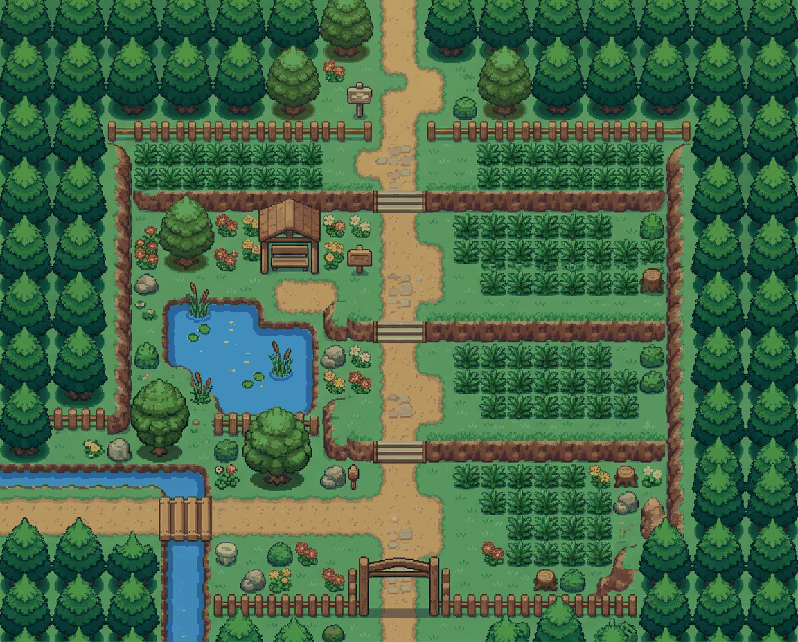
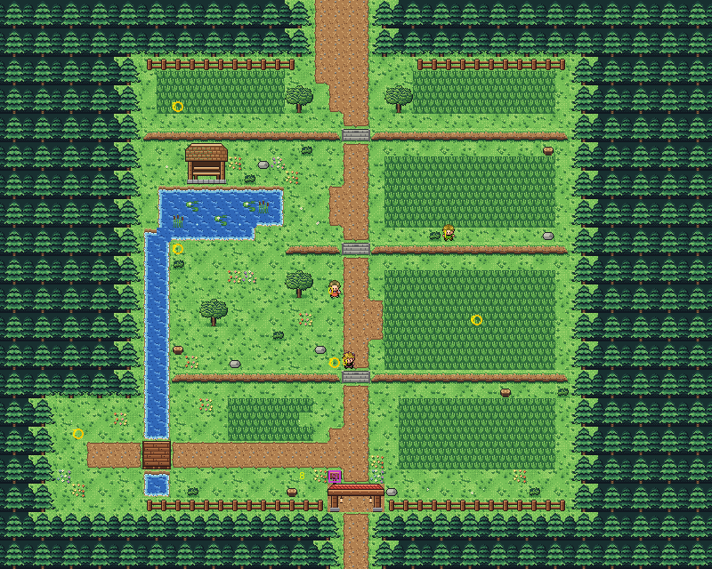
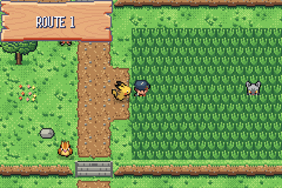
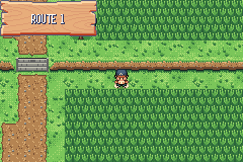
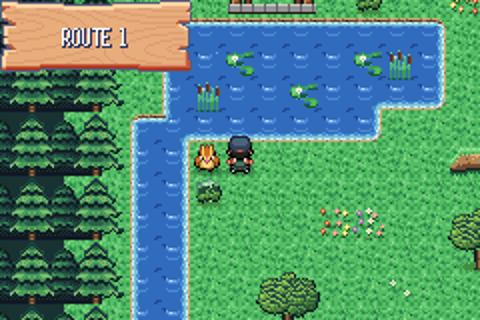
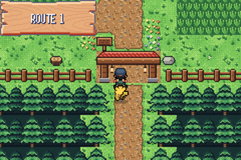
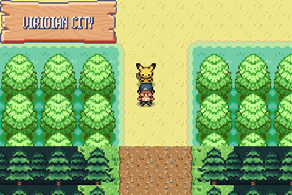
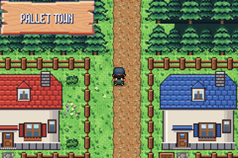

# Route 1 after the concept art

The next map after Pallet Town. `concept.png` was made with image generation in the style of the concept Pallet.
This folder builds that route in the game from the kit (`../kit`), the building blocks every rebuilt map shares,
plus two pieces of its own. Only the character sprites, Pokémon and story come from the game.

The route is 50×40 blocks, the same size as before, so its joins stay where they were. Viridian's road meets the
top at columns 22–25, and Pallet's road meets the bottom at columns 24–25 (see `../WORLD.md`). Between forest
walls, it has:
- a dirt road down through three ledges, with stone steps where the road goes down them;
- tall grass on both sides;
- a rest shelter by a pond with lily pads and reeds;
- a stream crossed by a little bridge on a side path to a clearing;
- a wooden arch where the road leaves Pallet.

## New in the kit for this route

- **Tall grass** in two kinds, staggered in a checkerboard: two fronds, and a sprig with cream flowers. They were
  drawn natively at 16×16, with their grass over the player's feet (`../kit/tall_grass/`), in their own palette
  (primary bank 4). Their ground shows the lawn's own texture (the lawn's greens take the palette's ground and free
  slots), so a patch sits in the lawn without a flat floor. Each kind has its own sprite over your feet, picked by
  the block you stand in (`pae tileset build`, `"field_effects"` with `"metatiles"`).
- **Ledges** you hop down going south, which round off at their ends.
- **Stone steps** through a ledge, walkable both ways.
- **The pond**, from a native pixel pack made with another AI from a brief (`../kit/pond/`, "gentle ripples"): open
  water in three kinds, the shores, outer and inside corners and a one-block pool, each 16×16 in eight frames in the
  water palette. `../kit/water.py` puts each block together from them; Pallet's pond and channel use it too.
- **Lily pads and reeds**, drawn over the pond's animated water (`{"auto": "pond", "joins": "~", "with": "lily"}`
  in the legend).

## Rebuild

From the repository root: `sh project/art/build_all.sh` rebuilds every map made from the kit, Pallet and Route 1.
They share the kit's primary tileset, so a change to the kit means building both again.
`sh project/art/route1-concept/build.sh` alone runs:

1. `make_art.py`: the kit's pieces, the shelter and the arch, `spec.json`, `grid.txt`, `legend.json`.
2. `pae tileset new` (the first time) and `pae map geometry`: the route's own tileset and its block files.
3. `pae tileset build` and `pae map paint`.
4. `pae map connect`: to Viridian City and Pallet Town, as before.
5. `pae seam build`: the edge strips across tilesets. Viridian has a hand-made seam for Route 22; pae's for
   Route 1 goes beside it.
6. `pae map place`: the events, at their new places.

## In game

Replay tests: `route 1 tall grass`, `route 1 tall grass plain block`, `route 1 ledge jump`, `route 1 steps up a ledge`,
`route 1 surf the pond`, `route 1 north to viridian`, `viridian looks at route 1`, `wild battle in grass`, `pallet north to route 1`,
`pallet route 1 looks at pallet`.
