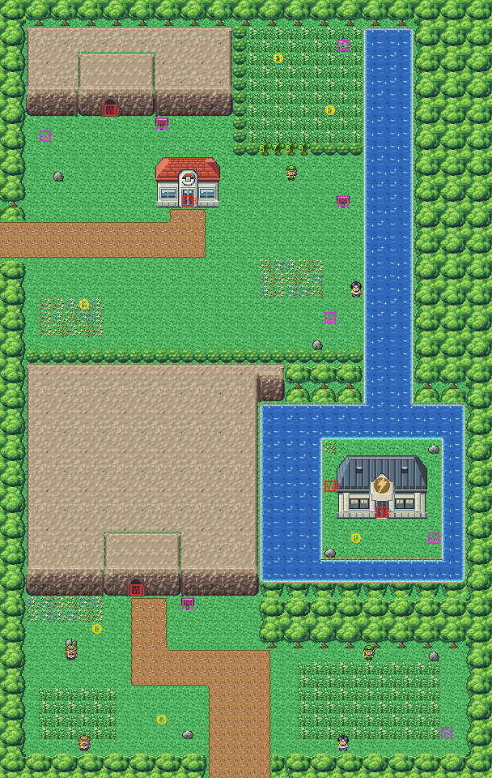

# Route 10 after its concept

Down the east of the mountains from Route 9 to Lavender, with Rock Tunnel under them, rebuilt from the kit (`../kit`).
The concept is this folder's own: `draw_plan.py` draws the block plan (`plan_stage1.txt`) from shapes and says why
things are where they are.

The route is 38×60 blocks (old Route 10 was 38×90), as wide as before, so Lavender's join stays where it was: its
road north meets the bottom at columns 16–20. Route 9's road meets the left edge at rows 17–19. It has:
- **the north clearing**, where Route 9's road comes in: the Pokémon Center, Rock Tunnel's north mouth in a ridge with
  its sign, and a meadow of grass behind a row of four young trees to cut, where the Voltorb roll about; Heidi and
  Mark off the road;
- **the river** down the east of the clearing, which can be surfed: it widens into **the lake** where the abandoned
  Power Plant stands on its island, with the Electabuzz; the plant can only be reached by water. It is Pewter's Gym
  with its plaque blank and a lightning bolt on its emblem (`buildings/power_plant`, written by `make_art.py`). Its
  back door lets you out on the island's west shore, and isn't a way in (KR-46);
- **the mountains** across the middle, with no way over them but Rock Tunnel: its south mouth faces south at their
  foot;
- **the south valley**, from the south mouth down to Lavender, with Carol, Clark, Herman and Trent off the road.

Every warp keeps its number and the people keep their order. The heal spot moved with the Center (14,16,
`src/data/heal_locations.json`, its old-map override dropped). The pieces are the kit's, the Pokémon Center (the
kit's), its cliffs and Route 2's cave mouth for Rock Tunnel's two mouths in the cliffs' palette (bank 7), and the plant
in its own (bank 9). The seams are pae's: with Route 9 both maps are the kit's, and old Lavender's colours fit in banks
10–12 but one of its palettes, drawn in its nearest colours (KR-44).

`make_art.py` checks the route's rules on the map it builds:
- only Route 9's road and Lavender's open onto the edges;
- from Route 9 you reach the clearing (the Center, the north mouth), the meadow only with the young trees cut, and the
  plant's island only by water;
- the mountains part the north from the south valley, which is reached from Lavender (the south mouth);
- everything walkable is reached one way or the other, and no trainer sees the road;
- the doors can be walked into and the signs read.

Build it from the repository root with `sh project/art/route10-concept/build.sh` (or every map with
`sh project/art/build_all.sh`).
