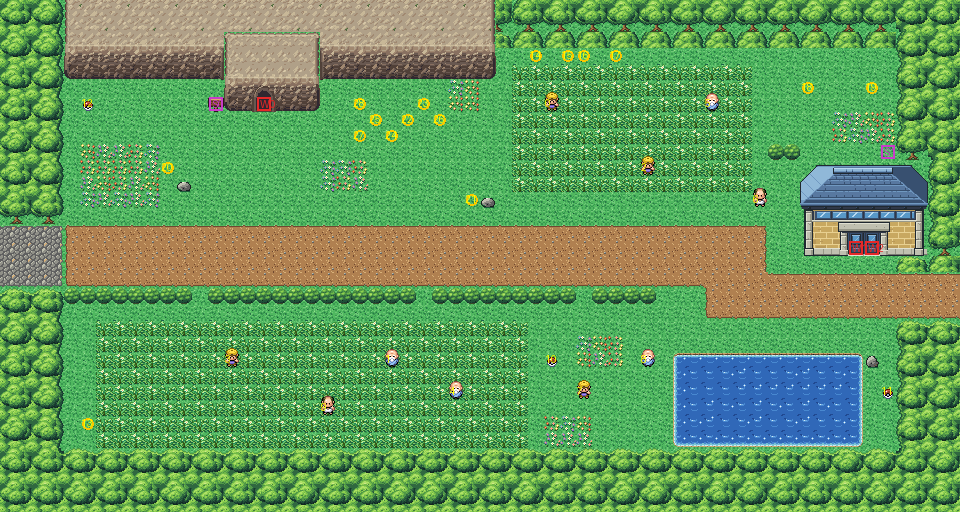

# Route 11 after its concept

The road east out of Vermilion to the gatehouse before Route 12, rebuilt from the kit (`../kit`). The concept is this
folder's own: `draw_plan.py` draws the block plan (`plan_stage1.txt`) from shapes and says why things are where they
are.

The route is 60×32 blocks (old Route 11 was 72×40), and its joins stay where its neighbours meet it: Vermilion's main
street meets the left edge at rows 14–17, Route 12's road the right edge at rows 17–20. It has:
- **the road**, Vermilion's cobbles carried on and then a dirt road east to Route 12. No trainer's sight is on it:
  Route 11's trainers are for those who go looking;
- **Diglett's Cave** in the north-west, its mouth (Route 2's: the same cave) set into a rock ridge, with its sign;
- **the Friends' clearing** east of the cave, where they camp (round 25,7, as before);
- **the north grass** and **the south grass**, where the gamblers, youngsters and engineers stand, behind a row of
  bushes with three gaps along the road's south side, and a pond in the south-east;
- **the gatehouse** (Route 2's south forest gate, as on Route 6) north of the road's east end: the way up to the
  Itemfinder. The road passes south of it to Route 12, where Snorlax sleeps. Its two doors are the halves of its
  double door, and lead to the inside's west and east doors (KR-40).

Every warp keeps its number and the people keep their order: the cave's mouth (16,6) and the gatehouse's doors
(53–54,15). The trainers keep their facings and sights; Dave walks his square and Yasu up and down by his flowers, as
before, nearer their places (`build.sh`). Old Route 11's hand-made seam was removed from `kanto_connection_seam.c`.
The pieces are the kit's, its cliffs and the cave mouth in the cliffs' palette (bank 7), and the gatehouse in its own
(bank 9). The seams are pae's: Vermilion is the kit's too, and old Route 12's colours fit in banks 10–11 (old Route
12 draws two of Route 11's palettes in its nearest colours, KR-39).

`make_art.py` checks the route's rules on the map it builds:
- only its two roads open onto the edges;
- everything walkable is reached from them;
- the road is in no trainer's sight;
- the cave's and the gatehouse's doors can be walked into from the block below them, and the sign read from it.

Build it from the repository root with `sh project/art/route11-concept/build.sh` (or every map with
`sh project/art/build_all.sh`).
