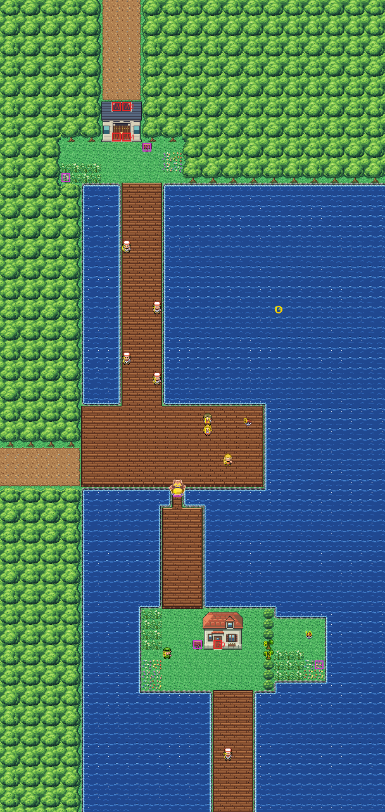

# Route 12 after its concept

Silence Bridge: south from Lavender over the sea to Route 13. It is rebuilt from the kit (`../kit`). The concept is
this folder's own: `draw_plan.py` draws the block plan (`plan_stage1.txt`) from shapes and says why things are where
they are.

The route is 38×80 blocks (old Route 12 was 38×90). Its joins stay where they were:
- Lavender's road south (its columns 13–15) comes in at the top edge, columns 10–13 (offset −2, KR-50), and its cobbles carry on to the gatehouse's back;
- Route 11's road (its rows 17–19) at the left edge, rows 44–47 (offset 27);
- Route 13's boardwalk (its columns 86–89) leaves the bottom edge at columns 21–24 (offset −65).

It has:
- **the north gatehouse** across the way down from Lavender between the woods: you walk in at its back doorway and
  out of its front door onto the cliff top. It is the only way down. From Kanto Buildings Remakes v0.3 (`../packs/buildings_v0.3/`)
  (`route12_gate`);
- **the cliff top**, a lookout over the sea, its tall grass (the Hyper Potion hidden in it), the route sign;
- **Silence Bridge**, the boardwalk south over the sea, Ned, Chip, Hank and Elliot fishing off it, a Carvanha in the
  water by it;
- **the fishers' deck**, where Route 11's road comes onto the bridge: Luca pacing it, Gia and Jes (who battle when
  spoken to) and TM48 on it;
- **Snorlax**, asleep in the neck one block wide at the deck's south side: the only way south. The Leftovers are
  hidden under him;
- **the fishing house** on its islet halfway down, its sign, tall grass by the bridge, Justin; behind a hedge at the
  islet's east end, a pocket of land closed by two trees to cut, with the Iron, tall grass, and the Rare Candy
  hidden;
- **the bridge south** from the islet to Route 13, Andrew fishing off it.

The kit's sea is solid scenery (KR-65): there is no surfing or fishing here (KR-70); the tall grass gives the route's
land encounters.

The warps keep their numbers: the fishing house (0), the gatehouse's back doorway (1, 2) and its front door (3). Warp
4 is new: the front door's right half, to the gatehouse's other south door (KR-71). The people, the items, the signs
and the hidden items keep their order.

The pieces: the kit's, the north gatehouse in Saffron's buildings' palette (bank 7), the fishing house (Viridian's
gardener's house) in Viridian's houses' palette (bank 9).

It was rebuilt with Route 13, in one pull request: old Route 12 had no tile slot left for a seam to the new Route 13.
Its old hand-made seam is gone from `kanto_connection_seam.c` (Route 21 South's seam keeps the water frames it shared
with it). The seams are pae's: with Lavender and Route 13 none (all the kit's); Route 11's own metatiles in its strip
are drawn here with 30 pieces, in bank 10.

`make_art.py` checks the route's rules on the map it builds:
- only the three ways open onto the edges;
- through the gatehouse, everything walkable is reached from Lavender's road, and the gatehouse is the only way down;
- with Snorlax asleep, Route 13 isn't reached from Lavender or Route 11, and Route 11's road is reached from Lavender;
- without the trees cut, the pocket isn't reached; the trees stand more than 8 blocks from the edges you come in by
  (KR-45);
- every door can be walked into (the gatehouse's back from above), every sign read;
- the people, items and hidden items are on open ground, and each trainer sees some of the way.

Build it from the repository root with `sh project/art/route12-concept/build.sh` (or every map with
`sh project/art/build_all.sh`).
