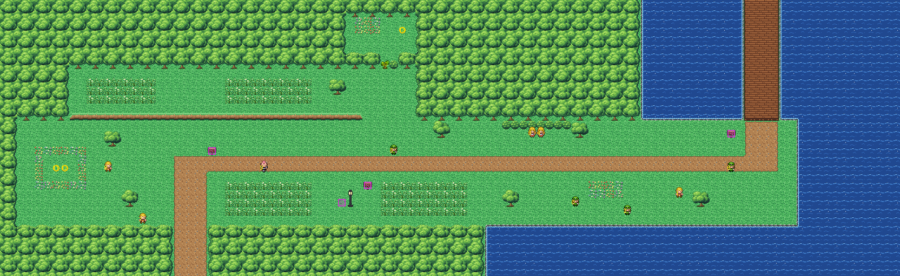

# Route 13 after its concept

The coast road west from Silence Bridge (Route 12's boardwalk) to Route 14. It is rebuilt from the kit (`../kit`). The
concept is this folder's own: `draw_plan.py` draws the block plan (`plan_stage1.txt`) from shapes and says why things
are where they are.

The route is 104×32 blocks, as before. Its joins stay where they were:
- Silence Bridge (Route 12's columns 21–24) comes down onto the top edge at columns 86–89 (offset 65);
- Route 14's way in (its columns 16–19) leaves the bottom edge at columns 20–23 (offset 4).

It has:
- **the boardwalk** down from Silence Bridge over the bay to the landing, the route sign there;
- **the coast road** west from the landing to Route 14. Gwen looks west along it from its east end, Jared looks
  about on it, Valerie waits by it at the way up to the meadow;
- **the headland** above the road, where Sheila and Lola sit looking down on it;
- **the cove** south of the road's east half: its shore, where Alma, Susie and Sebastian wander, and the sea;
- **the fields** south of the road's west half: tall grass either side of an old lamp post, the trainer tips sign
  by it ("look to the left of that post"): the PP Up is hidden just left of it;
- **the upland meadow** north of the road under the woods: tall grass, ledges along its south side down towards the
  road (one way; the path at its east end goes up), and behind a tree to cut, a nook in the woods where a Seedot
  lives;
- **the lovers' meadow** at the road's west end: a ring of flowers where Nidorino and Nidorina face each other, Perry
  looking east from beside it, Robert at the fields' foot looking up them; the second trainer tips sign (SELECT) by
  the road.

The trainers, the tree to cut and the Pokémon keep their order; the signs and the hidden item too. The route has no
warps. The pieces are all the kit's: the route has nothing of its own (its secondary tileset is empty).

It was rebuilt with Route 12, in one pull request: old Route 12 had no tile slot left for a seam to the new Route 13.
Both its neighbours are the kit's, so it has no seam.

`make_art.py` checks the route's rules on the map it builds:
- only Silence Bridge's boardwalk and Route 14's way in open onto the edges;
- everything walkable is reached from the boardwalk; without cutting, Route 14 is still reached but the nook isn't;
- the upland meadow is reached without the ledges;
- every trainer, Pokémon and tree stands on open ground and each trainer sees some of the way;
- the signs can be read; the PP Up is just left of the lamp post;
- the tree stands more than 8 blocks from the edges you come in by (KR-45).

Build it from the repository root with `sh project/art/route13-concept/build.sh` (or every map with
`sh project/art/build_all.sh`).
