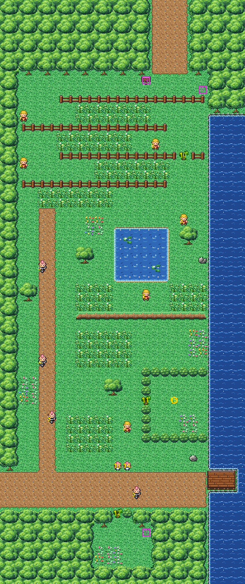

# Route 14 after its concept

Down the coast from Route 13 to where Route 15 turns west for Fuchsia. It is rebuilt from the kit (`../kit`). The
concept is this folder's own: `draw_plan.py` draws the block plan (`plan_stage1.txt`) from shapes and says why things
are where they are.

The route is 26×62 blocks, as before. Its joins:
- Route 13's path (its columns 20–22) comes in at the top edge, columns 16–19 (offset −4, as before);
- Route 15's low road (its rows 14–17) meets the left edge at rows 50–53 (offset 36, was 37: the road moved up a row
  to sit on the forest's grid, so Route 15's offset is −36 now).

It has:
- **the way in** from Route 13, down through the woods, the route sign at its foot;
- **the grass maze**: four lanes of tall grass between fences, each open at the other end from the last, so the way
  south zigzags through all four. Carter waits at the first lane's west end, Mitch paces the second's east end, Beck
  looks along the third, and Marlon, below the maze, watches the last lane's east end. A tree to cut in the third
  fence makes a short cut past the second and third lanes;
- **the clifftop meadow** below the maze: its pond with lily pads, its grass and trees, Donald wandering below the
  pond, and ledges along its south side down into the lower meadow (one way; the bikers' road goes round them);
- **the bikers' road** down the meadows' west side: Gerald and Isaac look across it, Lukas rides up and down it;
- **the lower meadow**, its grass, Benny wandering in it;
- **the Shroomish's dell** by the shore, behind a hedge, a tree to cut its way in;
- **the crossroads** at the bottom: the road west to Route 15, Malik looking east to the short pier, Jan and Kiri
  (who battle together) above it;
- **the berry garden** under the woods south of the road, behind a tree to cut (at 12,54: more than 8 blocks in
  from Route 15's edge, or the game would hide it, KR-69);
  the Pinap Berry is hidden in it. The Zinc is hidden by the shore at the maze's start.

The sea runs down the whole east side beyond a strip of shore: the kit's sea, solid scenery (KR-68).

The trainers, the trees to cut, the twins, the Shroomish, the sign and the hidden items keep their order. The route
has no warps.

The pieces are all the kit's: the route has nothing of its own (its secondary tileset is empty).

The seams are pae's:
- with Route 15 and with Route 13 (rebuilt after it), both are the kit's, so there is no seam. While Route 13 was
  old, it was drawn here with 31 pieces in banks 7, 9 and 10, and it drew this route's top seven rows with 45.

`make_art.py` checks the route's rules on the map it builds:
- only Route 13's path and Route 15's road open onto the edges;
- everything walkable is reached from Route 13's side;
- the trees stand more than 8 blocks from the edges you come in by (KR-45);
- without cutting, Route 15's road is still reached (the maze's short cut is only a short cut), but the dell and the
  berry garden aren't;
- every trainer, Pokémon and tree stands on open ground, no two on one block, and each trainer sees some of the way;
- the sign can be read, and the hidden items are on open ground;
- the top seven rows, which old Route 13 drew, are forest and dirt only (kept from then).

Build it from the repository root with `sh project/art/route14-concept/build.sh` (or every map with
`sh project/art/build_all.sh`).
