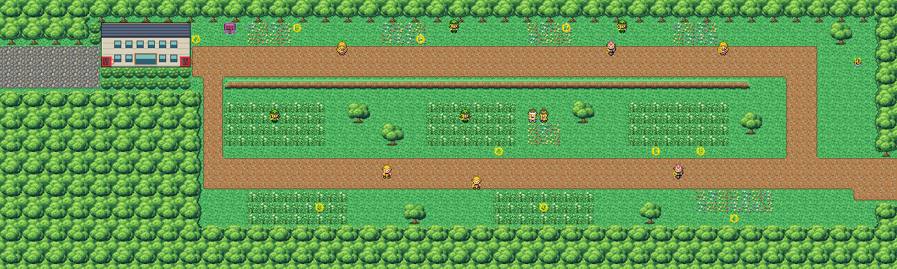

# Route 15 after its concept

The way east out of Fuchsia: two roads through the woods to Route 14. It is rebuilt from the kit (`../kit`). The
concept is this folder's own: `draw_plan.py` draws the block plan (`plan_stage1.txt`) from shapes and says why things
are where they are.

The route is 80×24 blocks (old Route 15 was 96×32, its south half solid forest). Its joins:
- Fuchsia's main street (its rows 20–23) comes in at the left edge, rows 4–7 (offset −16, was −15: the road moved up a
  row to sit on the forest's grid);
- Route 14's road (its rows 51–54) meets the right edge at rows 14–17 (offset −37, as before).

It has:
- **the gatehouse** at Fuchsia's edge, across the road: Route 16's Cycling Road gatehouse, with its doorways at its
  ends. It is the only way between Fuchsia and the route;
- **the high road** east from it along the woods' edge, with flowers on its verge. Olivia, Alex and Grace are on it,
  Becky and Celia among the flowers;
- **the ledges** along its south side, down into the meadow. They go one way only: the high road is reached from the
  low road by the slope at its east end;
- **the meadow** between the roads: tall grass in three patches, trees, and Ron and Mya, who battle together, by
  its flowers. Yazmin and Kindra are in its grass;
- **the low road** from the gatehouse round to Route 14, with Edwin looking back west along it, Chester looking up
  into the meadow, and Ernest. The south meadow's grass lies under the woods;
- **the lookout** at the high road's east end, where TM18 lies.

The gatehouse's warps keep their numbers: the west doorway (0) and the east one (1). The trainers, the TM, the
Pokémon about and the sign keep their order. Route 14's tree to cut, shown across the join, moved with the route's
new width (81,13).

The pieces are the kit's and the gatehouse (bank 7). The route takes 26 of its 384 tiles.

The seams are pae's:
- with Fuchsia, both are the kit's, so there is no seam;
- old Route 14 is drawn here with 25 pieces (39 tiles), in banks 9–10;
- old Route 14 draws this route's right seven columns (forest, lawn, dirt and a tree only) with 64 pieces, in its
  slots 7–8.

`make_art.py` checks the route's rules on the map it builds:
- only Fuchsia's road and Route 14's open onto the edges;
- with the hall walked through, everything walkable is reached;
- without it, Route 14's side doesn't reach Fuchsia's: the gatehouse is the only way;
- the high road is reached from the low road without the ledges;
- every trainer, Pokémon and the TM is on open ground, both doorways can be walked into and the sign read;
- the strip old Route 14 draws is forest, lawn, dirt and trees only.

Build it from the repository root with `sh project/art/route15-concept/build.sh` (or every map with
`sh project/art/build_all.sh`).
