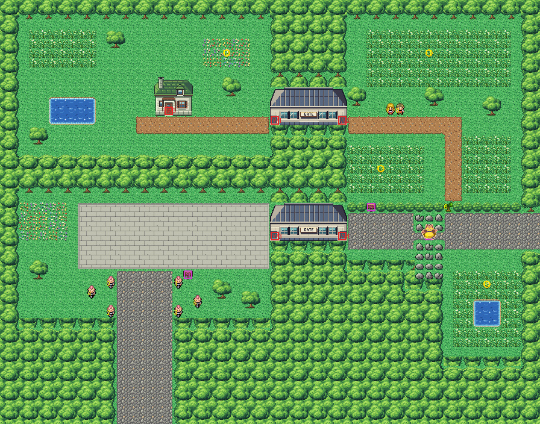

# Route 16 after its concept

Where Celadon's boulevard runs out west into a wooded valley and Cycling Road begins, rebuilt from the kit (`../kit`).
The concept is this folder's own: `draw_plan.py` draws the block plan (`plan_stage1.txt`) from shapes and says why
things are where they are.

The route is 56×44 blocks (old Route 16 was 64×52). Its two joins:
- Celadon's boulevard (its rows 20–23) meets the right edge at rows 22–25 (offset 2, was 7);
- Cycling Road (Route 17) starts below the bottom edge, its road at columns 12–17 (offset 0, as before).

It has:
- **the road west from Celadon**, where Snorlax sleeps in the one-block gap between two outcrops of rock. Nothing
  passes until the Poké Flute wakes him; the Leftovers he leaves are hidden where he lay (underfoot, found with the
  Itemfinder);
- **the Cycling Road gatehouse** beyond him. Its lower hall is open to bikes only (its guard's rule, inside), and leads
  through to the plaza at the top of Cycling Road, where six bikers hang out on either side of the road down. None of
  them sees the middle of the road;
- **the woodland path**, behind a tree to cut north of the road before Snorlax. It runs through the woods' tall grass,
  past Lea and Jed out walking, to the gatehouse's upper hall, which is open on foot;
- **the glade** beyond the upper hall, closed off from the plaza by the forest. The house in the woods there is where
  the girl who gives HM02 Fly lives;
- **the meadow** south of the road before Snorlax: tall grass round a pond.

The gatehouse is from Kanto Buildings Remakes v0.3 (`../packs/buildings_v0.3/`) (`cycling_gate`): a gatehouse across the road with a doorway at each end. The
left doorway is entered walking east and the right one walking west (arrow warps that don't animate), so the doors
match its inside's, which are on its west and east walls. It is the east-west gate pack the earlier gates lacked
(KR-40, KR-52, KR-60). The route has it twice, for the gatehouse's two halls.

Every warp keeps its number: the house (0), the upper hall's west and east doorways (1, 2), the lower hall's (3, 4).
The people keep their order; Celadon's clone of the tree to cut moved with it (−10,19).

The pieces: the kit's; the gatehouse in Saffron's buildings' palette (bank 9); Viridian's pond keeper's house (bank
7). The route takes 81 of its 384 tiles.

The seams are pae's:
- with Celadon, both maps are the kit's, so only 2 seam pieces are needed (pae PR #30: none for the kit's own
  metatiles);
- old Route 17's palettes fit exactly in banks 10–12 here, and this route's in Route 17's free slots 7–8. The bottom
  seven rows, which old Route 17 draws, are forest and road only.

Old Route 16's hand-made seam piece for Route 17 was removed from `kanto_connection_seam.c`.

`make_art.py` checks the route's rules on the map it builds:
- only Celadon's road and Cycling Road's open onto the edges;
- until Snorlax wakes, Celadon's side reaches neither the lower hall nor Cycling Road, and until the tree is cut, not
  the woodland path;
- with both, and the halls walked through, everything walkable is reached, and the glade only through the upper hall:
  there is no way round the gatehouse's bike rule;
- the tree stands more than 8 blocks from the edges you come in by (KR-45);
- the road down to Cycling Road is in no biker's sight;
- every doorway can be walked into, and every sign read;
- the strip old Route 17 draws is forest and road only.

Build it from the repository root with `sh project/art/route16-concept/build.sh` (or every map with
`sh project/art/build_all.sh`).
