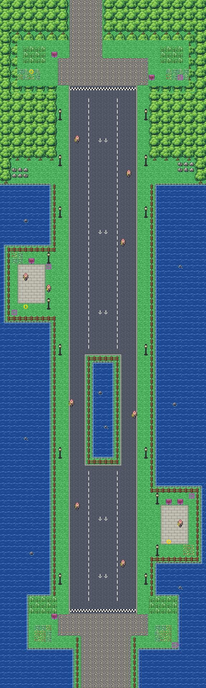

# Route 17 after its concept

Cycling Road: the downhill run from the wooded heights of Route 16 to the shore of Route 18, by bike only. It is
rebuilt from the kit (`../kit`). The concept is this folder's own: `draw_plan.py` draws the block plan
(`plan_stage1.txt`) from shapes and says why things are where they are.

The route is 36×120 blocks (old Route 17 was 33×158). Its two joins:
- Route 16's road down from the plaza (its columns 12–17) comes in at the top edge, at the same columns (offset 0, as
  before);
- the road on to Route 18 leaves by the bottom edge at columns 14–22, onto Route 18's meadow (its columns 8–16;
  offset 6, as before).

It has:
- **the start**, at the top of the hill. The road from Route 16 opens onto a clearing in the woods, with tall grass
  either side, Houndour in its flowers and the route sign. Below it is a cobbled start area, where the track begins at
  a chequered line.
- **the track**, twelve blocks wide with three lanes painted on it, all one slope the bike runs down by itself. It goes
  down a cutting through the woods to the cliff top, then out over the sea on a causeway, fenced on both sides, with
  lamps along its verges. The middle lane is in no biker's sight from the start line to the lagoon.
- **the lagoon**, halfway down. The causeway splits round a stretch of open sea (its two sea rocks inside a fence), the
  track in two lanes either side, and a biker across each lane watches it: pick your lane, and your battle.
- **two rest stops** off the causeway, a paved lay-by on each side: the west one above the lagoon (Grimer about it,
  the notice about discarded items) and the east one below it (Gulpin, the notices about Poké Balls and growth).
  They are flat ground where a rider can stop, and the bikers gather there.
- **the finish**, where the causeway comes ashore. A chequered line, then a cobbled plaza where the slope ends ("the
  slope ends here"), the shore's grass and flowers, and the road on to Route 18 between two fences.

The track is drawn here (`route17_track.py`), in its own palette (bank 7):
- smooth tarmac, edged with a stone kerb wherever it meets something else;
- paint on it: the lane lines, arrows pointing downhill, the chequered start and finish lines.

Every piece of it is a slope (`MB_CYCLING_ROAD_PULL_DOWN`): on the bike, it carries you down whenever you press no
direction. Holding B doesn't keep you in place, though the trainer tips sign says it does: this engine ignores B on
the bike (KR-67). The track joins the kit's cobblestones without a kerb.

The tall grass at the start and on the shore is new: old Route 17 had wild Pokémon in its encounter table but no grass
to meet them in.

The people keep their order: the ten bikers (0–9), then Gulpin, Grimer and Houndour (10–12). The signs and hidden
items keep theirs too. The five hidden items are by flat ground, never on the slope, which would carry you off before
you could look:
- the Rare Candy in the clearing's flowers;
- the Full Restore and the Max Revive at the west rest stop;
- the PP Up at the east rest stop;
- the Max Elixir on the shore.

The kit gained the sea's inside corners for the causeway's rest stops and shore (the sea pack's own `in_*` pieces):
every map was rebuilt.

The pieces: the kit's and the track (bank 7). The route takes 37 of its 384 tiles, all the track's.

The seams are pae's:
- with Route 16, both maps are the kit's and each strip is the kit's own metatiles (forest and road), so there is no
  seam at all;
- old Route 18 is drawn here with 37 seam pieces (62 tiles), its palettes in banks 9–11;
- old Route 18 draws this route's strip, the bottom seven rows, with 14 pieces (34 tiles), the kit's palettes in its
  free slots 8 and 10. The strip is only sea, fences and cobblestones.

`make_art.py` checks the route's rules on the map it builds:
- only Route 16's road and Route 18's open onto the edges;
- everything walkable is reached from the top;
- the track runs unbroken from its start line to its finish line;
- every biker and Pokémon stands on open ground;
- every sign can be read, and every hidden item found, from flat ground;
- paint is only where the track goes on all round;
- the strips the neighbours draw are their kinds of ground only.

Build it from the repository root with `sh project/art/route17-concept/build.sh` (or every map with
`sh project/art/build_all.sh`).
