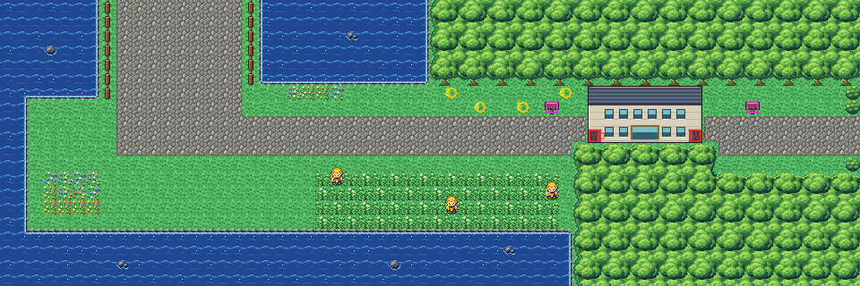

# Route 18 after its concept

The end of Cycling Road: the road down from Route 17's finish turns east along the shore to the gatehouse, and on to
Fuchsia. It is rebuilt from the kit (`../kit`). The concept is this folder's own: `draw_plan.py` draws the block plan
(`plan_stage1.txt`) from shapes and says why things are where they are.

The route is 60×20 blocks, as before. Its two joins stay where they were:
- Route 17's road (its columns 14–22) comes in at the top edge, at columns 8–16 (offset −6), between the same two
  fences;
- Fuchsia's west road (its rows 18–20) meets the right edge at rows 8–10 (offset −10).

It has:
- **the road down** from Cycling Road's finish to the shore, between Route 17's fences;
- **the shore road** east along the coast, the sea west and south of it, to the gatehouse. It is by bike only, as
  Cycling Road is: the gatehouse's guard turns walkers back;
- **the meadow** north of the road under the woods: two Dodrio running up and down it, two Kecleon at the woods'
  edge;
- **the rockers' grass** south of the road, on the bluff over the sea: Wilton, Ramiro and Jacob wait in the tall
  grass, and none of them sees the road;
- **the gatehouse** across the road, the only way between Cycling Road and Fuchsia, with woods north and south of it;
- **the road on to Fuchsia** beyond it, out of the woods.

The gatehouse is Route 16's Cycling Road gatehouse (`../route16-concept/route16_buildings.py`, `cycling_gate`), here
in bank 7. Its two doorways are arrow warps: the left one entered walking east, the right one walking west. They
match the inside's doors, which are on its west and east walls. Its warps keep their numbers: the west doorway (0) and
the east one (1).

The people keep their order: the three rockers (1–3), then the Kecleon, the two Dodrio and the other Kecleon (4–7).
The two signs keep theirs too.

The pieces are the kit's and the gatehouse. The route takes 26 of its 384 tiles.

The seams are pae's:
- with Route 17, both maps are the kit's and both strips are the kit's own ground, so there is no seam at all;
- old Fuchsia is drawn here with 72 pieces (148 tiles), its colours packed into palette slots 5 and 9–12;
- old Fuchsia draws this route's strip, the right seven columns, with 43 pieces in its slots 4 and 11. The strip is
  only forest, lawn, road and hedges.

`make_art.py` checks the route's rules on the map it builds:
- only Route 17's road and Fuchsia's open onto the edges;
- with the hall walked through, everything walkable is reached;
- without it, Fuchsia's side doesn't reach Cycling Road's: the gatehouse is the only way;
- the rockers wait in the grass and none of them sees the road;
- the Pokémon stand on open ground;
- both doorways can be walked into, and both signs read;
- the strip old Fuchsia draws is forest, lawn, road and hedges only.

Build it from the repository root with `sh project/art/route18-concept/build.sh` (or every map with
`sh project/art/build_all.sh`).
