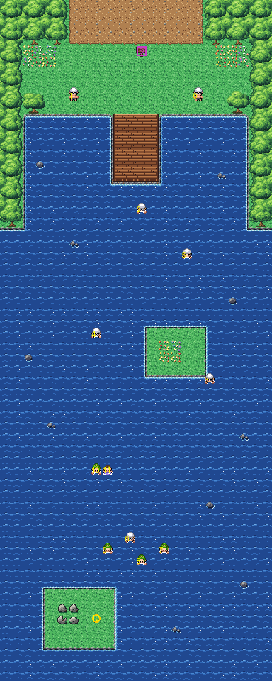

# Route 19 after its concept

The sea route south from Fuchsia City. It is rebuilt from the kit (`../kit`). The concept is this folder's own:
`draw_plan.py` draws the block plan (`plan_stage1.txt`) from shapes and says why things are where they are.

The route is 24×60 blocks, as before. Its joins stay where they were:
- Fuchsia's beach path (its columns 18–29) comes down onto the top edge at columns 6–17 (offset −12);
- Route 20's sea (its rows 0–18) meets the left edge at rows 41–59 (offset 41).

It has:
- **the beach** at the foot of Fuchsia's path, between the woods: its flowers, the route sign, Reece and Richard
  resting on it before they go in;
- **the jetty** out from the beach, where you start to surf;
- **the channel** south between the rocks, Tony, David, Matthew and Douglas swimming in it; **the sandbar islet**
  halfway down, its flowers;
- **the rock island** at the bottom, where a Wingull nests; Axle, Alice, Connie and Anya swimming together, Lia and
  Luc (who battle together); the sea west to Route 20.

The swimmers and the Wingull keep their order; the sign too. The route has no warps. The pieces are all the kit's (its
secondary tileset is empty). It was rebuilt with Route 20, in one pull request, after Cinnabar: every join on the sea
route is between kit maps now, so it has no seam.

`make_art.py` checks the route's rules on the map it builds:
- only Fuchsia's path opens onto the top edge, and Route 20's sea onto the left;
- the beach is reached on foot from Fuchsia; by Surf from the jetty, every island and Route 20's side are reached;
- the swimmers are in the water and the people and the Wingull on land, each sees some of the way;
- the sign can be read.

Build it from the repository root with `sh project/art/route19-concept/build.sh` (or every map with
`sh project/art/build_all.sh`).
