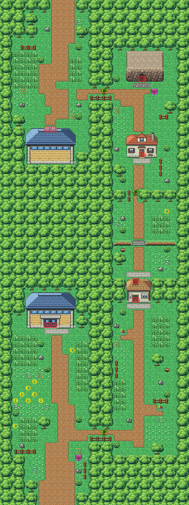
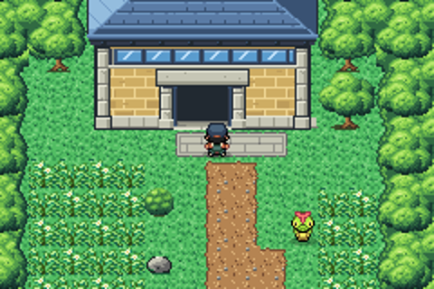
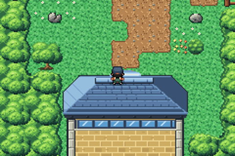
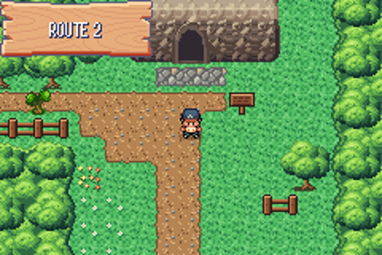
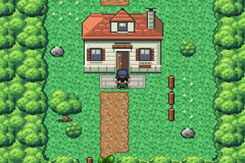
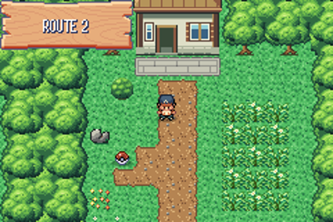
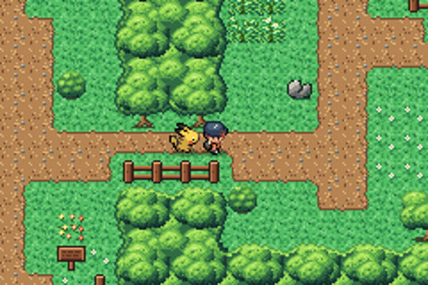
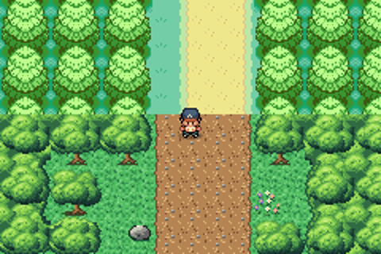

# Route 2 after the concept

The road north from Viridian City to Pewter City, past Viridian Forest. The plan and the packs were made with
another AI from a brief: a concept and block plan (`concept.png`, `plan_stage1.txt`, `plan_metadata.json`), then
native pixel packs for what's new (Route 2 Stage 2 Assets v0.3, `buildings/`). This folder builds the route from the
kit (`../kit`), those packs and Viridian's family house.

The route is 30×80 blocks, as before, and joins its neighbours where it did: Pewter's road meets the top at columns
8–11, Viridian's the bottom at columns 6–11. It has:
- **the south meadow**, from Viridian: the road, tall grass, the Friends' camp (a lawn west of the road, columns
  2–7, rows 60–63) and the forest's south gate. Without Cut that gate is the only way on;
- **Viridian Forest** (a map of its own, not rebuilt yet) between the gates. Nothing outside joins the two meadows;
- **the north meadow**, from the forest's north gate: tall grass and the road to Pewter;
- **the eastern detour**, with Cut, one tree at a time: two items on short spurs; the small east gatehouse (in at
  its south door, out at its north one; it can't be walked round); a ledge with stairs; the north enclave with the
  trade house and the north entrance of Diglett's Cave; then back to the north meadow.

`make_art.py` checks the plan's rules on the map it builds, with every way of cutting the three trees: the forest
is the only way north without Cut, each tree opens only its part of the detour, the gatehouse can't be walked
round outside, the camp is reachable from Viridian, and every door and item can be reached.

## The buildings

Only what's new was drawn; the trade house is Viridian's.

| Letter | Building | From | Bank | Doors |
|---|---|---|---|---|
| `F` | the forest's south gate, 8×6 | `buildings/forest_gate_south` | 7 | a double door (two blocks), animated as one |
| `N` | the forest's north gate, 8×6 | `buildings/forest_gate_north` | 7 | its doorway in the roof's cutaway: you step on it walking south and keep going |
| `E` | the east gatehouse, 4×4 | `buildings/east_gatehouse` | 9 | drawn open: the south door is entered walking north, the north door walking south |
| `U` | the trade house, 5×4 | `../viridian-concept/buildings/house_family` (Viridian's family house, as it is) | 9 | its own animated door |
| `D` | Diglett's Cave, 6×5 | `buildings/diglett_cave` (the Route 22 rock and cliff pack's top and face, a mouth cut in) | 10 | the mouth, entered walking north |

- **Tiles.** The pack was re-exported once (v0.3) so its 8×8 tiles repeat: the five buildings take 285 of the
  route's 384 tiles (`buildings/tile_report.md`).
- **Palettes.** The gatehouse and the house share bank 9. The gatehouse's colours are the house's but two, which go
  in two entries the house doesn't use (`make_art.py`, `share_palette`). Bank 8 is the kit's plants palette, and
  11–12 are free for the seam to Pewter (not rebuilt yet): pae packs that strip's colours into those two slots.
- **The double door.** The game animates a door one block wide, so `src/field_door.c` gains double doors (two door
  blocks side by side, two blocks tall). Both blocks open together, whichever one you walk into. `pae door add`
  makes them from the pack's 96×32 frames. Their frames are copied to tiles 434–449, which the kit reserves (it
  reserved 434–441 for doors until now).
- **The forest.** The kit gains three inside corners for this forest (`kit.FOREST_CORNERS`).

## Events

- **Warps** to the old interiors, as before: the forest's gatehouses (both blocks of each double entrance go to
  the same place), the east building (its south door, then its north one), the trade house and Diglett's Cave.
- **The three trees to cut** are FireRed's tree on the path (Viridian's is the same); the old fourth tree went.
- **The two item balls** (the Ether and the Paralyze Heal) and the two signs (the route's, by the road from
  Viridian, and Diglett's Cave's) moved to the plan's spots. Caterpie, Weedle and Zigzagoon stand about the
  meadows.
- **The Friends' camp**: the seven keep their shape around Brian, at (5,62). Their anchor in
  `src/data/friends_scene_locations.h` is Brian's block and his local id (9 now: it was one off before, 11 for
  Brian's 10).

## Rebuild

From the repository root: `sh project/art/build_all.sh` rebuilds every map made from the kit.
`sh project/art/route2-concept/build.sh` alone runs `make_art.py`, `pae tileset new` (the first time),
`pae map geometry`, `pae tileset build`, `pae map paint`, `pae map connect` (Pewter, Viridian), `pae seam build`,
`pae door add` and `pae map place` for the events.

## In game

Replay tests: `route 2 forest gate double door opens`, `route 2 into the forest south gate`,
`route 2 out of the forest south gate`, `route 2 into the forest north gate`, `route 2 out of the forest north gate`,
`route 2 east gatehouse south door`, `route 2 east gatehouse north door`, `route 2 trade house door`,
`route 2 into diglett cave`, `route 2 cut the south tree`, `route 2 looks at pewter`, `pewter looks at route 2`,
`route 2 looks at viridian`, `viridian north to route 2`. The story check walks the route from Viridian to the forest's
south gate, through the forest, and from its north gate to Pewter (`project/docs/story-sanity-check.md`).
