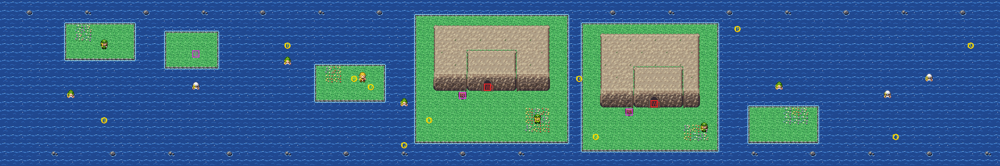

# Route 20 after its concept

The sea route west from Route 19 to Cinnabar Island, past the Seafoam Islands. It is rebuilt from the kit (`../kit`).
The concept is this folder's own: `draw_plan.py` draws the block plan (`plan_stage1.txt`) from shapes and says why
things are where they are.

The route is 120×20 blocks, as before. Its joins stay where they were:
- Cinnabar's sea meets the left edge (offset 0);
- Route 19's sea (its rows 41–59) meets the right edge at rows 0–18 (offset −41).

It has:
- **the sandbars** along the way, where the picnickers and a camper rest and the Seel and Dewgong haul out (the
  Stardust is hidden on one);
- **the Seafoam Islands**, two rocky islands in the middle, each with a cave's mouth facing south onto its shore and
  the islands' sign by it: the caves join under the sea (warps 0 and 1, to Seafoam's two south doors, as before);
- **the open sea** between, the swimmers in it, sea rocks along the route's edges.

The warps keep their numbers; the people, the Pokémon, the signs and the hidden Stardust keep their order. The pieces:
the kit's, its cliffs for the islands and Route 2's cave mouth for Seafoam's two mouths, in the cliffs' palette (bank
7), as Route 10 has them for Rock Tunnel's. It was rebuilt with Route 19, in one pull request, after Cinnabar: every
join on the sea route is between kit maps now, so it has no seam.

`make_art.py` checks the route's rules on the map it builds:
- there is nothing to walk on at the edges (the route is crossed by Surf);
- by Surf from Route 19's side, every island and sandbar, both caves' mouths and Cinnabar's side are reached;
- each mouth's door can be walked into from the shore below it, and the two islands' shores aren't joined on foot;
- the swimmers are in the water, the people on land, each sees some of the way;
- the Stardust is on a sandbar; the signs can be read.

Build it from the repository root with `sh project/art/route20-concept/build.sh` (or every map with
`sh project/art/build_all.sh`).
