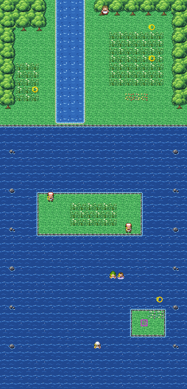
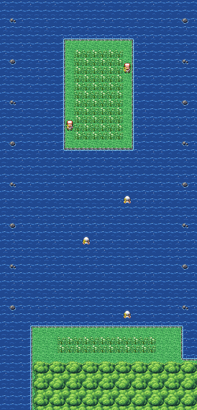

# Route 21 after its concept

The sea route south from Pallet Town to Cinnabar Island, in two maps (north and south). It is rebuilt from the kit
(`../kit`). The concept is this folder's own: `draw_plan.py` draws the two block plans (`plan_north.txt`,
`plan_south.txt`) from shapes and says why things are where they are.

 

Each map is 24×50 blocks, as before. Their joins stay where they were:
- Pallet's river (its columns 18–21) comes down onto the north map's top edge at columns 7–10 (offset −11);
- the two maps meet across their whole width (offset 0);
- Cinnabar's top (its columns 0–23) is below the south map (offset 0): the woods behind its Mansion and Gym, and the
  sea lane down the island's west side (columns 0–3).

The north map has:
- **Pallet's river**, running down between two meadows (Mr. Mime's, and the Tangela's tall grass) to the beach, and
  out over its bar into the sea: the river is the kit's pond, the sea the kit's sea; where they meet, both draw their
  shores, a shoal you surf over;
- **the fishers' islet** in the open sea, Ronald and Wade fishing off its north and south shores, tall grass between;
- **the pearl sandbar** further south (the Pearl hidden on it), Spencer swimming his round west of it, Lil and Ian
  together, Corphish by it.

The south map has:
- **the long islet**, its tall grass between Claude (fishing off its east shore) and Nolan (its west);
- **the open sea**, Jack, Jerome and Roland swimming in it;
- **Cinnabar's north shore** at the foot: the beach and its tall grass, and the woods behind the island's town.

The trainers and the Pokémon keep their order; the hidden Pearl too. The route has no warps. The pieces are all the
kit's: the two maps share one secondary tileset, which holds nothing of their own.

It was rebuilt with Cinnabar Island, in one pull request, so that every join is between kit maps and needs no seam.

`make_art.py` checks the route's rules on the maps it builds:
- by Surf from Pallet's river, every beach, islet and sandbar of both maps is reached, and the lane to Cinnabar;
- on foot nothing leaves either map: the river's banks under Pallet's woods are the only land on the north map's top
  edge; the south map's foot is woods and sea only;
- the swimmers and Corphish are in the water, the fishers and the meadows' Pokémon on land, each sees some of the way;
- the Pearl is on the sandbar; both maps have tall grass (the route has land encounters).

Build it from the repository root with `sh project/art/route21-concept/build.sh` (or every map with
`sh project/art/build_all.sh`).
