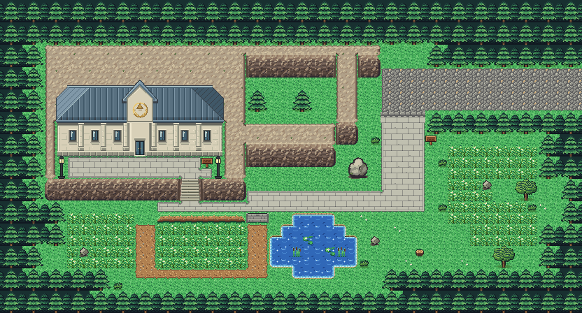
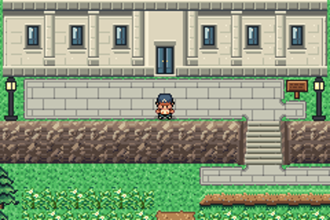
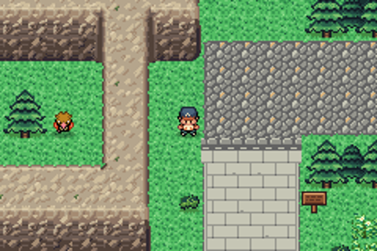
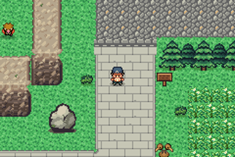
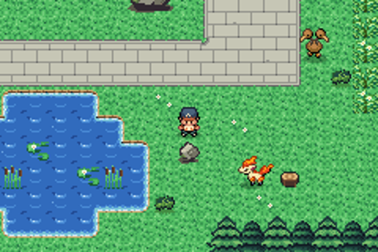
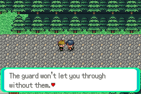

# Route 22 after the concept

The hilly route west of Viridian City to the Pokémon League Front Gate. The plan and the packs were made with
another AI from a brief: a concept and block plan, then native pixel packs for what's new: the League Front Gate,
a dressed-stone paving for the League approach (`concept_comparison.png` puts the approved concept beside them) and,
redone after the first cliffs, a rock and cliff pack (now the kit's, `../kit/rock_cliff/`). This folder builds the route from the kit
(`../kit`) and those packs.

The route is 52×28 blocks, as before. The road from Viridian leaves the right edge at rows 6–9 (Viridian's rows
28–31), and Blue meets you on its straight stretch. It has:
- the League Front Gate (15×10 blocks, two storeys) in the northwest, set into the cliff, on a stone forecourt up a
  flight of stairs in the cliff;
- rocky cliffs and terraces between forest walls;
- a dressed-stone approach from the road down to the gate, where it meets the cobblestones through joins;
- tall grass on both sides, a pond with lily pads and reeds, a ledge with steps, round trees and rocks.

`plan.txt` is the stage 1 plan (`plan_stage1.txt`) with the cliffs' faces two blocks tall, as the pack draws them:
the forecourt's edge is a face now, with the pack's stairs (its old steps' rows are forecourt; a round tree below it
went), its lamps stand at its ends, and a big boulder stands east of it. The gate is a storey taller, filling the cliff
behind its old roof, and the terrace east of it ends square with the ridge beside it.

## New pieces

- **The dressed-stone paving** (`../kit/paving/`) is in the kit's ground palette (its colours are the kit's), so every
  map can use it: `p` in a grid, with joins to cobblestones and dirt (`paving_to_cobble_N` and the like).
- **The rock and cliff pack** (`../kit/rock_cliff/`, its `README.md`, drawn by the kit's `cliffs.py`; bank 9). Every
  map can use it, but the kit has no palette slot left, so each map gives it a bank of its own tileset. `C` in the
  plan is a cliff's whole footprint:
  - the bottom two blocks of each column of it are its **face**, the pack's 16×32 columns: an outer end beside the
    lawn or forest, an inner end where it meets a cliff top or the stairs reaching further south, and the three
    middles mixed between;
  - the rest is its **top**: the pack's texture repeats every three blocks from the map's corner (its nine phases),
    each block with the edges its neighbours call for (the pack's recipes). Where a top's side meets a face (a
    ridge between terraces) it takes the pack's face joins instead of its lawn edge (revision 3.2: the side starting
    beside the face's upper block and running on beside its lower one, the corner above it); the corner tops sit
    flush on the face's outer ends. The cliff is solid, top and face;
  - the **stairs** (`H`, 2×2) are in the face below the forecourt; the forecourt and the road open onto them;
  - its **rocks**: the small one stands for the kit's rock here (`o`), the big boulder (`X`) east of the forecourt.
    The pack's breakable rock isn't used yet (nothing on the route breaks rocks).
- **The League Front Gate** (`buildings/`, bank 7), two storeys: `make_art.py` adds the upper one from the pack's
  own pixels (the ground floor's wall and windows again, a window over the door, the plinth's stones as a band
  course between the floors). Its top four rows (the roof) stand against the cliff (`U` in the grid,
  joined to the cliff so it shows no edge there; the cliff's top shows under its roof, by phase: pae's ground for
  each block), its front over the lawn (`L`). Its door animates from its drawn frames (`pae door add --frames`).

## Rebuild

From the repository root: `sh project/art/build_all.sh` rebuilds every map made from the kit.
`sh project/art/route22-concept/build.sh` alone runs `make_art.py` (which checks the road to Viridian is open, the
gate's door and the tall grass are reachable, Blue's road is clear and every cliff has room for its face),
`pae tileset new` (the first time), `pae map geometry`, `pae tileset build`, `pae map paint`, `pae map connect`
(Viridian), `pae seam build`, `pae door add` and `pae map place` for the events.

Blue's scenes (`data/maps/Route22_Frlg/scripts.inc`): he appears seven blocks west of you in the row you're in
(`getplayerxy` and `setobjectxyperm`), so one trigger a row (6–9) does for the four-row road. He walks up to you,
battles, and leaves: east toward Viridian the first time, west toward the League the second.

Route 22 isn't joined to Route 23 anymore: that join was only seen across the top (both edges are solid; you go
through the gate), and Route 23's strip needs more palettes than Route 22 has free. Each shows its own border there
until Route 23 is rebuilt (`../WORLD.md`).

## In game

Replay tests: `viridian west to route 22`, `route 22 looks at viridian`, `route 22 enter the league gate`,
`route 22 up the stairs to the gate`, `route 22 blue on row 7`, `route 22 blue on row 9`.
