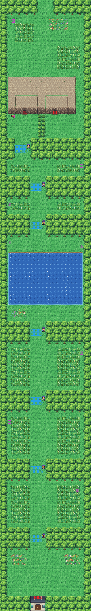

# Route 23 after its concept

The road to the Pokémon League: north from the League gate through the badge gates to Victory Road and, out of it,
up to Indigo Plateau. It is rebuilt from the kit (`../kit`). The concept is this folder's own: `draw_plan.py` draws the
block plan (`plan_stage1.txt`) from shapes and says why things are where they are.

The route is 24×160 blocks, as before. Its joins:
- Indigo Plateau's road (its columns 10–13) meets the top edge at columns 10–13 (offset 0, as before);
- Route 22's woods are below the bottom edge (offset 0). The two weren't joined while Route 23 was the old map
  (WORLD.md); both are the kit's now, so they are joined again.

It has, from the south:
- **the League gate's back**, its doorway out onto the road (warps 2 and 3, the gate's way out, as before): Route 12's
  north gatehouse, only its doorway open (the double door below it is the map's bottom edge, shut);
- **the badge gates**: six narrow passes through the woods (Cascade, Thunder, Rainbow, Soul, Marsh, Volcano), a
  guard in each pass's east column who stops you without the badge, meadows of tall grass between them;
- **the lake** past the Soul Badge's gate, crossed by Surf (the Soul Badge lets you use it), its shores;
- **the Earth Badge's gate**, the last, into the yard under Victory Road's cliff: its way in (warp 0) and its sign;
- **Victory Road's way out** (warp 1), in the same cliff, opening into a yard of its own behind a hedge: the lane up
  beside the cliff to the meadow on the cliff top, and the road north out of it to Indigo Plateau.

Each gate is a pass four blocks wide: the guard stands in its east column, and the three blocks beside him, on his
row and the next, are the gate's triggers (six each: the old route's 42 coord events, which were 5 to 10 a gate). Each
keeps its gate's script and the step of the road it checks (`VAR_MAP_SCENE_ROUTE23`, 1 at Cascade's gate to 7 at
Earth's), so the gates still open one after another. The guards and the hidden items keep their order; the warps
their numbers.

The pieces: the kit's, its cliffs for Victory Road's cliff and Route 2's cave mouth for its two mouths, in the cliffs'
palette (bank 7), as Routes 10 and 20 have them; Route 12's north gatehouse for the League gate's back, in Saffron's
buildings palette (bank 9). The old route's layout was in FireRed's metatile format; its build sets the kit's.

`make_art.py` checks the route's rules on the map it builds:
- only Indigo Plateau's road opens onto an edge;
- out of the League gate, by Surf (the lake), the gates and Victory Road's way in are reached, and its way out isn't:
  its yard, the lane and the cliff top are reached only from Indigo Plateau's road (and the way out);
- the lake can't be crossed on foot;
- each gate closes the road: with its guard and its first row of triggers in the way, nothing north of it is reached;
  the guard and the triggers stand on open ground, with room below to be sent back;
- the sign can be read, the hidden items are on open ground, there is tall grass.

Build it from the repository root with `sh project/art/route23-concept/build.sh` (or every map with
`sh project/art/build_all.sh`).
