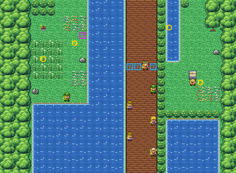

# Route 24 after its concept

Nugget Bridge, north out of Cerulean over the lake, rebuilt from the kit (`../kit`). The concept is this folder's
own: `draw_plan.py` draws the block plan (`plan_stage1.txt`) from shapes and says why things are where they are.

The route is 30×22 blocks, as before, and its exits stay where its neighbours meet it: Cerulean's bridge road meets
the bottom at columns 16–19, and Route 25 the top at its west path (columns 7–10), its bridge (16–19) and its east
path (24–25). It has:
- **the bridge**, the whole way up the middle, a rail of bushes along its east side. Its five trainers stand across
  it in turn, each at a side looking at the other: they see all four blocks of its width (three blocks, set by
  `build.sh`), so none of them can be passed unseen. At its north end the Rocket waits, his three triggers across
  the bridge at row 8 where they were (his scene walks him one block along it);
- **the west shore**, a meadow off Route 25's west path above the lake, with the TM, a berry hidden in the grass,
  tall grass with Abra in it, and Shane the camper watching it from its foot;
- **the east meadow**, off Route 25's east path, where the shelter's traveler looks after a Charmander;
- **the lake** west of the bridge (it runs on into Cerulean's), and east of the bridge's foot a pond that carries on
  Cerulean's water east of its bridge, closed off by bushes, so Cerulean's yard is still reached only through its
  house.

The people keep their order and scripts. The route has nothing of its own in its tileset: every piece is the kit's,
so the seams to its neighbours use the kit's palettes.

`make_art.py` checks the route's rules on the map it builds: only its exits open onto the edges; each trainer's row of
the bridge is all in a trainer's sight, and the bridge can't be crossed past them or the Rocket's triggers; the shore
and the meadow are reached from Route 25 and not from the bridge; the pond at the bridge's foot can't be surfed into
from here; everything walkable is reached from an exit.

Build it from the repository root with `sh project/art/route24-concept/build.sh` (or every map with
`sh project/art/build_all.sh`).
