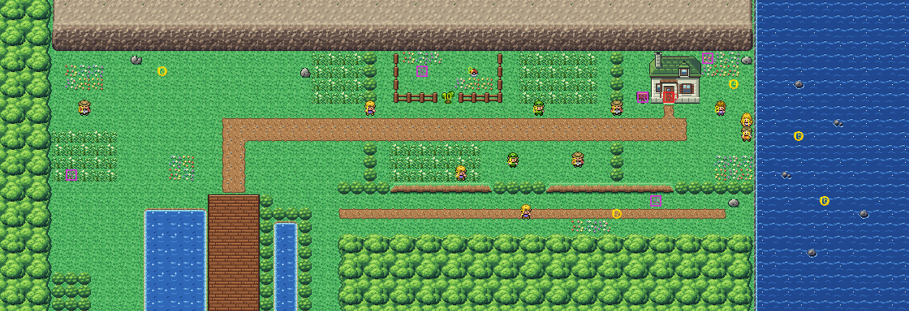

# Route 25 after its concept

Cerulean's cape, north of Nugget Bridge, rebuilt from the kit (`../kit`). The concept is this folder's own:
`draw_plan.py` draws the block plan (`plan_stage1.txt`) from shapes and says why things are where they are.

The route is 70×24 blocks (old Route 25 was 112×35), a road east under a rock ridge to Bill's Sea Cottage, with the
sea beyond. Its only exits are where Route 24 meets its bottom, as before: Route 24's west path (columns 7–10), the
bridge (16–19) and its east path (24–25). It has:
- **the landing**, where the bridge's last span comes up and Route 24's two paths meet it. There is grass along the
  forest (the hidden Elixir is in it), the lake's channel west of the bridge (Route 25's water Pokémon) and a stream
  east of its rail;
- **the cape road**, east along the foot of the ridge through two necks. At each the meadow narrows to the road
  between rows of bushes, and a trainer stands in the row above the road, looking down across it: Joey at the first,
  Wayne ("You're going to see BILL? First, we battle!") at the second. So the cottage can't be reached without
  beating them. Between the necks the couple, Kelsey and Flint, stand either side of the road, Dan looks round the
  grass south of it and Nob stands below it: each sees part of the road only;
- **the garden** under the ridge, fenced, with the tree to cut in its gate: TM43 and a hidden Ether are inside;
- **the trail below**, under the meadow's ledges. You hop down from the road (one way) and it takes you back west to
  Route 24's east path and the landing: a shortcut back to the bridge. Chad walks to and fro along it, watching it,
  Butterfree flies over it, and the Oran Berry is hidden on it;
- **the headland**: Bill's cottage (Viridian's pond keeper's house) under the ridge, with its sign by the door and
  its path up to the door; the ridge ends in a hedge above the sea. Haley
  stands on the headland, and at the lookout over the sea the couple stands beside Spearow, with the Bluk Berry
  hidden in the flowers. Luvdisc swim in the sea, which is the kit's: it can't be surfed.

The people keep their order and scripts. Wayne faces down now (he faced right), Chad walks left and right (he
walked up and down), and Spearow and Butterfree stand at the ground's elevation (they stood on old Route 25's
ledges). The pieces are the kit's, its cliffs in bank 7 and the cottage in Viridian's houses' palette in bank 9.
Route 24 is the kit's alone, so the seam between the two needs no palette of either's own.

`make_art.py` checks the route's rules on the map it builds:
- only Route 24's three ways in open onto the edges;
- each neck is all in its trainer's sight, and the cottage can't be reached past them unseen (but can past them);
- the tree closes the garden;
- the ledges lead down to the trail, and the trail leads back west only;
- everything walkable is reached, the cottage's door can be walked into and its sign read.

Build it from the repository root with `sh project/art/route25-concept/build.sh` (or every map with
`sh project/art/build_all.sh`).
