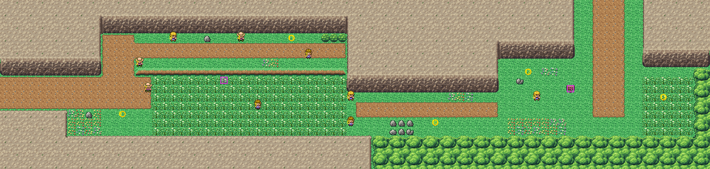

# Route 3 after its concept

The mountain road east from Pewter City, rebuilt from the kit (`../kit`) and its cliffs. The concept is this folder's
own: `draw_plan.py` draws the block plan (`plan_stage1.txt`) from shapes and says why things are where they are.

The route is 84×20 blocks, as before, and its exits stay where its neighbours meet it: Pewter's road east meets the
left edge at rows 9–12, Route 4's road the top at columns 68–75. Along a valley between the mountains it has:
- **the high path**, a shelf under the northern cliff reached by a lane north from the way in, with four trainers
  (Ben, Greg, Sally, James); its way on is down its ledge into the grass;
- **the field**, tall grass across the whole valley floor (it can't be walked round), Colton and Calvin and Janice
  watching across it and Robin wandering in it;
- past a rocky outcrop, **the rest stop** with the route sign and the hiker from Cerulean, and **the pass north** to
  Route 4 and Mt. Moon, with more grass east of it.

The trainers keep their scripts, their battles and the way they face; only their places moved. The route's own
tileset is the cliffs (bank 7); banks 9–12 stay free for the seam to Route 4, which isn't rebuilt yet.

`make_art.py` checks the route's rules on the map it builds: only the two exits open onto the edges; everything
walkable is reached from Pewter's road; the way north crosses the tall grass, from the high path too.

Build it from the repository root with `sh project/art/route3-concept/build.sh` (or every map with
`sh project/art/build_all.sh`).
