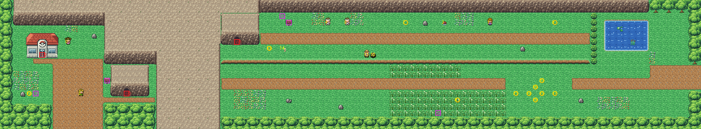

# Route 4 after its concept

The road round Mt. Moon, rebuilt from the kit (`../kit`), its cliffs and Route 2's cave mouth. The concept is this
folder's own: `draw_plan.py` draws the block plan (`plan_stage1.txt`) from shapes and says why things are where they
are.

The route is 108×20 blocks, as before, and its exits stay where its neighbours meet it: Route 3's pass meets the
bottom at columns 8–15, Cerulean's road the right edge at rows 10–13. Mt. Moon fills the west third, and only its
cave goes through it:
- **the foot of the mountain**: Route 3's road comes up past the Pokémon Center (its heal spot in front of it, 6,9)
  to Mt. Moon's mouth under the mountain's face;
- **the high shelf**, where the cave comes out (its far mouth, set into the cliff): Jessie and Meowth by the mouth,
  the route sign, the two martial artists who teach Mega Punch and Mega Kick, the stranger by his rock, Crissy and
  the TM. Its only way on is down its ledge, so the far mouth can't be reached from Cerulean;
- **the road down to Cerulean**, past tall grass, the Friends' camp (their third scene, at 83,14, where it was) and a
  pond under the cliff.

Every warp keeps its number and the people their order (scenes call the stranger's rock and Jessie and Meowth by
number). The route's own tileset is the cliffs and the cave mouth, both in the cliffs' palette (bank 7). Old
Cerulean had no room for the seam to the new route, so Cerulean is rebuilt in the same pull request.

`make_art.py` checks the route's rules on the map it builds: only the two exits open onto the edges; the mountain
divides the route (the Center and the near mouth are reached from Route 3's road); the far mouth can't be reached from
Cerulean, and the shelf's ledge leads there; everything walkable is reached from an exit or the far mouth.

Build it from the repository root with `sh project/art/route4-concept/build.sh` (or every map with
`sh project/art/build_all.sh`).
