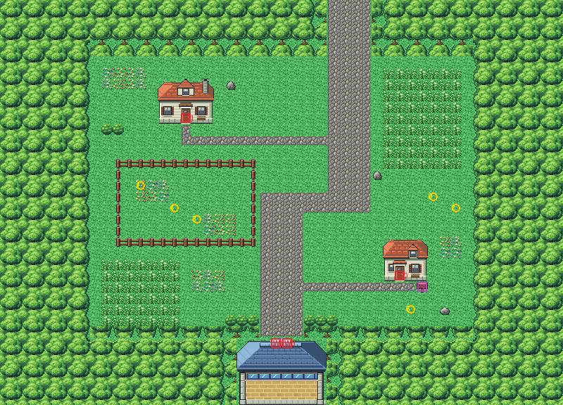

# Route 5 after its concept

The garden road south from Cerulean to Saffron's north gate, rebuilt from the kit (`../kit`). The concept is this
folder's own: `draw_plan.py` draws the block plan (`plan_stage1.txt`) from shapes and says why things are where they
are.

The route is 50×36 blocks (old Route 5 was 68×46), and its joins stay where its neighbours meet it: Cerulean's neck
meets the top at columns 29–32, and Saffron lies below, its own gate door (its columns 28–29) under this gate's top
door (24–25). It has:
- **the lane** out of Cerulean's neck, its cobbles carried on through a belt of forest and down the road;
- **the Day Care** (Viridian's family house) west of the road, with a fenced paddock below it where the Pokémon left
  there play: two Meowth and Spinda;
- **the Underground Path's hut** (Viridian's gardener's house) east of the road, its sign by the door and a lane of
  cobbles to it: the way under Saffron to Vermilion;
- **Saffron's north gate** at the bottom (Route 2's north forest gate): you walk into its top from the road. All
  four of its old warps are kept, on its two door blocks;
- tall grass in the east meadow and the south-west corner, Pidgey (by day) and Hoothoot (by night) by the forest,
  and a Meowth by the hut.

The people keep their order (Spinda stands at the ground's elevation now). The pieces are the kit's, the two houses
in Viridian's houses' palette (bank 9) and the gate in its pack's palette (bank 7). Old Route 5's hand-made seam is
removed from `kanto_connection_seam.c`. The seam with Cerulean is pae's and needs no palettes. There is none with old
Saffron yet: it has no tile slot left for this route's strip, and neither can see the other (the gate and the forest
fill this route's bottom rows, the gatehouse and forest Saffron's top ones). It comes with Saffron's rebuild.

`make_art.py` checks the route's rules on the map it builds:
- only Cerulean's neck opens onto the edges;
- everything walkable but the paddock is reached from it, and the paddock from nowhere;
- every door can be walked into (the houses' from below, the gate's from the road above it), and the sign read.

Build it from the repository root with `sh project/art/route5-concept/build.sh` (or every map with
`sh project/art/build_all.sh`).
