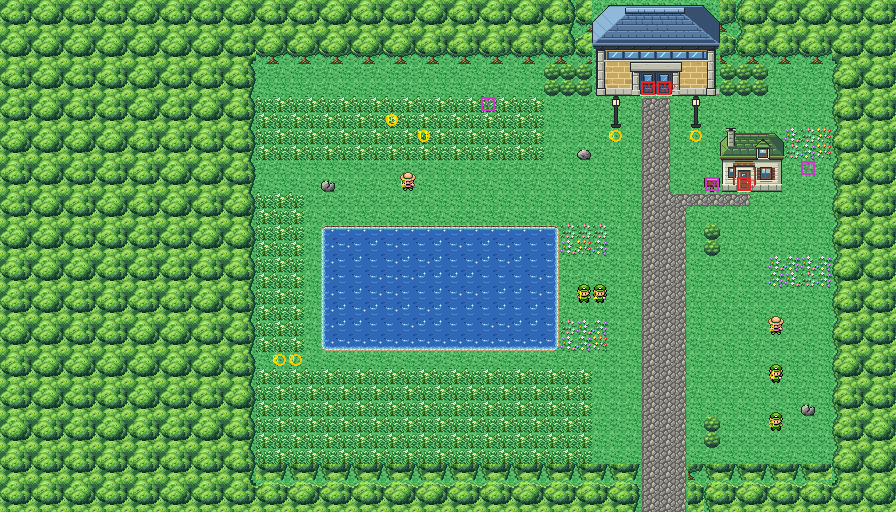

# Route 6 after its concept

The park south of Saffron, between its south gate and Vermilion, rebuilt from the kit (`../kit`). The concept is
this folder's own: `draw_plan.py` draws the block plan (`plan_stage1.txt`) from shapes and says why things are where
they are.

The route is 56×32 blocks (old Route 6 was 63×36), its x the same, so its joins stay where its neighbours meet it:
Vermilion's stairs meet the bottom at columns 40–42, and Saffron lies above, its own gate door (its columns 28–29)
over this gate's door (40–41). It has:
- **Saffron's south gate** at the top (Route 2's south forest gate, the twin of Route 5's), lamps either side of its
  door where the Magnemite gather;
- **the road** of cobbles from the gate down to Vermilion's stairs, in no trainer's sight;
- **the Underground Path's hut** (Viridian's pond keeper's house) east of the road, its sign by the door: the way
  back under Saffron to Cerulean;
- **the pond** in the park's middle. Ricky and Nancy talk on its east shore ("Quit listening in on us!": you talk to
  them to battle) and Keigo stands on the lawn north of it, where there aren't many bugs. Tall grass lies round it
  to the south and west, Plusle and Minun play in the north meadow, Granbull and Snubbull sit by the south one;
- **the east lawn** beside the road, where Elijah, Isabelle and Jeff stand looking across it (they see part of the
  lawn, not the road), with the hidden Rare Candy in its corner. The Sitrus Berry is hidden in the north meadow.

The people keep their order and scripts. `build.sh` sets the trainers' facings and sights to the plan's (Ricky and
Nancy face each other and see no one, as before), and the Pokémon stand at the ground's elevation. The pieces are the
kit's, the hut in Viridian's houses' palette (bank 9) and the gate in its pack's palette (bank 7).

Old Vermilion has no palette slot left for this route's strip, so from Vermilion the route's forest, grass and
ground are drawn in Vermilion's nearest colours (at most 82 RGB steps off), and Route 6 shows three of Vermilion's
palettes a little off (at most 50). Both go with Vermilion's rebuild (next). As with Route 5, there is no seam with
old Saffron (KR-34).

`make_art.py` checks the route's rules on the map it builds:
- only Vermilion's stairs open onto the edges;
- everything walkable is reached from them;
- the road from the gate to Vermilion is all cobbles and in no trainer's sight;
- both doors can be walked into from below, and the sign read.

Build it from the repository root with `sh project/art/route6-concept/build.sh` (or every map with
`sh project/art/build_all.sh`).
