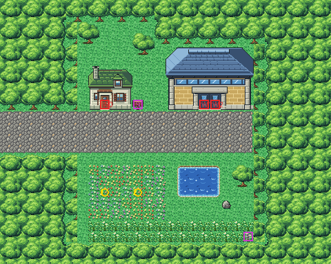

# Route 7 after its concept

The short park road from Celadon's east street to Saffron's west gate, rebuilt from the kit (`../kit`). The concept is
this folder's own: `draw_plan.py` draws the block plan (`plan_stage1.txt`) from shapes and says why things are where
they are.

The route is 30×24 blocks (old Route 7 was 20×28). Celadon's street (its rows 12–15) meets the left edge at rows
10–13 (Celadon's offset to it is now 2, was 8). Saffron lies beyond the right edge, reached only through the gate: its
own west gate door (its row 27) is level with this gate's (row 9), as with the old route (offset −18, was −15). It has:
- **the road** of cobbles, four blocks wide as Celadon's street is, out of the trees at Celadon's edge to the gate;
- **Saffron's west gate** at the road's east end (Route 2's south forest gate, as on Routes 6 and 8). Both its door
  blocks lead in: the right one is a second warp (2) to the same door inside;
- **the Underground Path's hut** (Viridian's pond keeper's house) north of the road with its sign: the way under
  Saffron to Route 8 and Lavender;
- **the singing garden** south of the road, a bed of flowers where the Jigglypuff sings to the Ralts, by a little
  pond, with tall grass along its south side, where Route 7's wild Pokémon live, and the Wepear Berry hidden in its
  corner.

Every warp keeps its number and the Pokémon their order; they stand at the ground's elevation. Celadon's border tree
is still shown across the join where it stands on Celadon's grid (the clone, now at −7,19). The pieces are the kit's,
the hut in Viridian's houses' palette (bank 9) and the gate in its pack's palette (bank 7).

The seams are pae's. Route 7 draws old Celadon's strip exactly (its palettes fit in banks 10–11). Old Celadon has no
free tile or palette slot for this route's strip, only 106 tile slots it never shows: so the strip it shows (the west
seven columns) is forest and road only, and two of its palettes are drawn in Celadon's nearest colours (at most 72 RGB
steps off: the cobbles look a little purple from Celadon, KR-54). That goes with Celadon's rebuild (next). There is
no seam with Saffron's twin, as for Routes 5, 6 and 8 (KR-34): no block of this route is in view of it, and old
Saffron draws no neighbour (KR-53). Old Route 7's hand-made seam (three of Saffron's blocks, drawn from Saffron's
tiles) was removed from `kanto_connection_seam.c`.

`make_art.py` checks the route's rules on the map it builds:
- only Celadon's street opens onto the edges;
- no block you can walk to is within 7 of the right edge;
- everything walkable is reached from Celadon, and the road to the gate is all cobbles;
- the strip old Celadon draws (the west seven columns) is forest and road only;
- every door can be walked into from below, and the sign read.

Build it from the repository root with `sh project/art/route7-concept/build.sh` (or every map with
`sh project/art/build_all.sh`).
