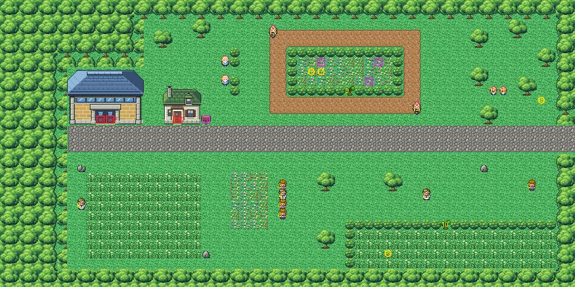

# Route 8 after its concept

The road west from Lavender to Saffron's east gate, where Lavender's townsfolk come out to race and to gamble, rebuilt
from the kit (`../kit`). The concept is this folder's own: `draw_plan.py` draws the block plan (`plan_stage1.txt`)
from shapes and says why things are where they are.

The route is 60×30 blocks (old Route 8 was 68×40, half of it mountain). Lavender's street meets the right edge at rows
13–15 (Lavender's offset to it is now −4, was −10). Saffron lies beyond the left edge, reached only through the gate:
its own gate door (its row 27) is level with this gate's (row 12), as with the old route (offset −15, was −6). It has:
- **the road** of cobbles from Lavender to the gate, in no trainer's sight, with the Underground Path's hut
  (Viridian's pond keeper's house) north of it and its sign: the way under Saffron to Route 7 and Celadon, as
  Saffron's gates are shut;
- **Saffron's east gate** at the road's west end (Route 2's south forest gate, as on Route 6). Both its door blocks
  lead in: the right one is a second warp (2) to the same door inside;
- **the stands** west of the track, where the gamblers Rich and Stan watch the race over a rail of bushes (their sight
  stops at it: you talk to them to battle);
- **the old race track**, a loop of dirt round a hedged berry garden. The bikers Ricardo and Jaren ride round its
  outer edge clockwise from opposite corners, one chasing the other (walk sequences with a range of 15×8, the most a
  range can be). The garden is behind a tree to cut, with the Rawst, Lum and Leppa Berries hidden in it and Growlithe
  and Vulpix playing;
- **the pine grove** in the north-east, where the twins Eli and Anne stand together (and Duskull at night);
- **the grass field** south-west of the road, Aidan at its edge;
- **the picnic lawn** south of the road, where Paige, Leslie, Andrea and Megan stand in their row by a cloth of flowers,
  looking out both ways, with Glenn and Julia further east;
- **the meadow** of grass in the south-east, behind a hedge and the second tree to cut, Kadabra in it.

The people keep their order and scripts. `build.sh` turns Rich to the track and sets the bikers' loop; the others keep
their facings and sights, and the Pokémon stand at the ground's elevation. The pieces are the kit's, the hut in
Viridian's houses' palette (bank 9) and the gate in its pack's palette (bank 7). The seam with Lavender is pae's (both
from the kit: it needs no palettes). There is none with Saffron's twin, as for Routes 5 and 6 (KR-34): every block of
this route is at least 7 in from the left edge, so the camera never shows it; and old Saffron itself draws no neighbour
(its joins aren't compiled, KR-53).

`make_art.py` checks the route's rules on the map it builds:
- only Lavender's street opens onto the edges;
- no block you can walk to is within 7 of the left edge;
- the trees close the berry garden and the meadow, and with them cut everything walkable is reached; they stand more
  than 8 blocks from the right edge (the game hides one nearer the edge you come in by: KR-45);
- the road from Lavender to the gate is all cobbles and in no trainer's sight, the bikers' whole loop included;
- every door can be walked into from below, and the sign read.

Build it from the repository root with `sh project/art/route8-concept/build.sh` (or every map with
`sh project/art/build_all.sh`).
