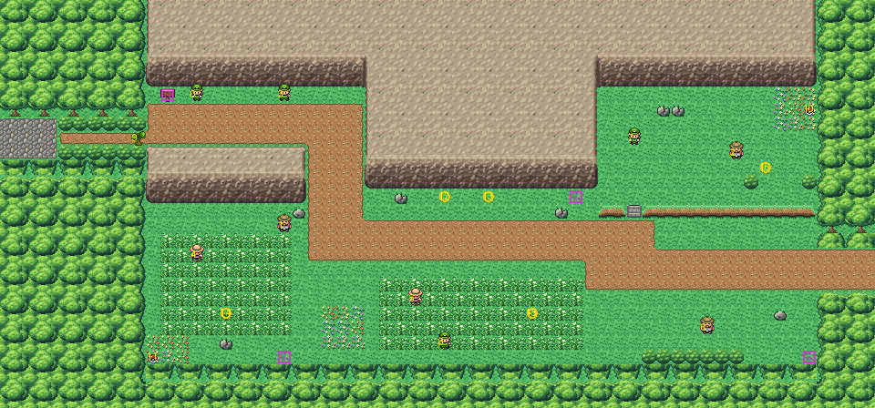

# Route 9 after its concept

The hill road east from Cerulean to Rock Tunnel, rebuilt from the kit (`../kit`). The concept is this folder's own:
`draw_plan.py` draws the block plan (`plan_stage1.txt`) from shapes and says why things are where they are.

The route is 60×28 blocks (old Route 9 was 65×60, its top half solid mountain). Cerulean's road east meets the left
edge at rows 8–10 (Cerulean's 28–30, where its edge opens), and the road out meets Route 10 at rows 17–19. It has:
- **the way in**: Cerulean's cobbles carried on, then a neck in the forest that the tree to cut closes. The tree stands
  at 9,9: the game hides a tree to cut that is within 8 blocks of the edge you come in by (`SetHideObstacleFlag`), so
  one nearer Cerulean would vanish as you walk in (KR-45). Cerulean shows it across the join (its clone, moved here);
- **the gorge**: the road between two cliffs, where the picnicker Alicia and the camper Chris stand under the northern
  cliff and look straight across it: you can't pass them without a battle;
- **the west field** below the gorge's southern cliff, with Jeremy and Brent off the road, reached where the road turns
  south round **the outcrop**, the Marowak at its foot;
- **the middle field** below the road (Conner, Drew), **the terrace** up a flight of steps in its ledge (Caitlin, Alan,
  the Aron, TM40 at its far end; hop down the ledge anywhere), and **the road out** east, with Brice on the lawn south
  of it.

Every trainer keeps his or her script and battle; Alicia and Chris now look down across the gorge (`build.sh`). Old
Route 9's hand-made seam was removed from `kanto_connection_seam.c` (with it, its dead entries for old Cerulean,
KR-18). The pieces are the kit's and its cliffs (bank 7). The seams are pae's: Cerulean and Route 10 are the kit's too.

`make_art.py` checks the route's rules on the map it builds:
- only its two roads open onto the edges;
- the tree closes the way in, and stands more than 8 blocks in;
- with the tree cut, everything walkable is reached, and Cerulean is reached back from Route 10 (ledges hopped south
  only);
- Alicia and Chris can't be passed without a battle, and no other trainer sees the road;
- the sign can be read.

Build it from the repository root with `sh project/art/route9-concept/build.sh` (or every map with
`sh project/art/build_all.sh`).
