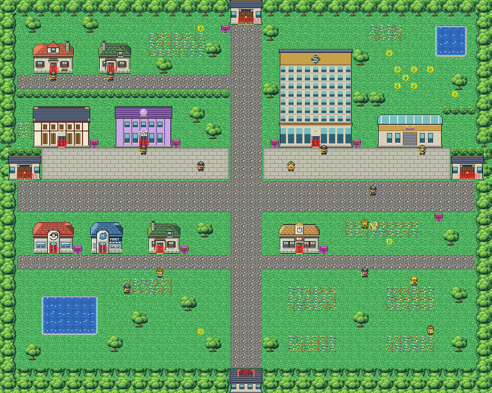

# Saffron City after its concept

Kanto's golden city of commerce at the region's crossroads, rebuilt from the kit (`../kit`). The concept is this
folder's own: `draw_plan.py` draws the block plan (`plan_stage1.txt`) from shapes and says why things are where they
are.

The city is 60×48 blocks (old Saffron was 66×55). Its joins aren't compiled: the routes around it join its twin,
`SaffronCity_Connection`, still the old layout, and keep clear of it (KR-34). From inside Saffron nothing shows beyond
its edges but its border's forest, so its size is its own and it has no seams. Two avenues cross in its middle, each
ending at a stone gatehouse, the way out to a route:
- **the north, west and east gatehouses** (to Routes 5, 7 and 8) have their double door on their south face, onto the
  avenue. The west and east ones' right door blocks are new warps (15, 16) to the same gatehouse doors;
- **the south gatehouse** (to Route 6) is entered walking south, through a doorway in its roof's back edge.

The rest of the city:
- **the north-west**: Copycat's house and a house on a lane off the avenue. The Fighting Dojo and Sabrina's Gym stand
  side by side on the Gym square, its paving running to the avenue. Until Silph Co. is freed, Rockets stand at the
  Gym's door, at Copycat's and at the house's;
- **the north-east**: Silph Co.'s tower, the tallest building in Kanto, on the Silph plaza. Its Rocket guard stands in
  its door until Mr. Fuji is rescued, then sleeps beside it. Next to it is the Magnet Train station: the train from
  Goldenrod comes in in front of it, and its attendant arranges the journey back. Behind them is a garden with a pond
  where the Friends camp (scene 10, round 50,8);
- **the south**, along a street parallel to the avenue: the Pokémon Center, the Mart, Mr. Psychic's house and the
  Pokémon Trainer Fan Club. Saffron Park lies below it, with its pond in the south-west and flower gardens in the
  south-east.

Every warp keeps its number and the people their order. Every other spot fixed to the map moved with it:
- the heal spot (6,31, `src/data/heal_locations.json`; its old-map override dropped);
- the Friends' camp (`src/data/friends_scene_locations.h`);
- the credits' view (38,4, panning down past Silph Co.);
- where the Magnet Train lets you off (49,18, `GoldenrodCity_TrainStation_hns/scripts.inc`);
- where the guard stands until Mr. Fuji is rescued (38,18, the city's map script).

The attendant (the worker, who used to wander) now stands by the station.

The pieces:
- the kit's ground and plants, and its Pokémon Center and Mart;
- six buildings drawn for the city by `saffron_buildings.py` in one palette (bank 9): Silph Co., Sabrina's Gym, the
  Fighting Dojo, the two gatehouses and the station. The Gym's and Dojo's doors are Pewter Gym's frames recoloured; the
  gatehouse's double door is drawn there too;
- Viridian's houses in their palette (bank 7): the family's for Copycat's house, the pond keeper's for the house and
  Mr. Psychic's;
- Viridian's trainer school in its own (bank 10) for the Fan Club.

The city takes 307 of its 384 tiles. See `../ASSETS.md` for every pack and how to replace one.

`make_art.py` checks the city's rules on the map it builds:
- nothing walkable on its edges;
- everything walkable is reached from the avenues' crossing;
- every door can be walked into (the south gatehouse's from above), and every sign read;
- the Friends' camp, the train's stop and the walkers' paths are open ground.

Build it from the repository root with `sh project/art/saffron-concept/build.sh` (or every map with
`sh project/art/build_all.sh`).
