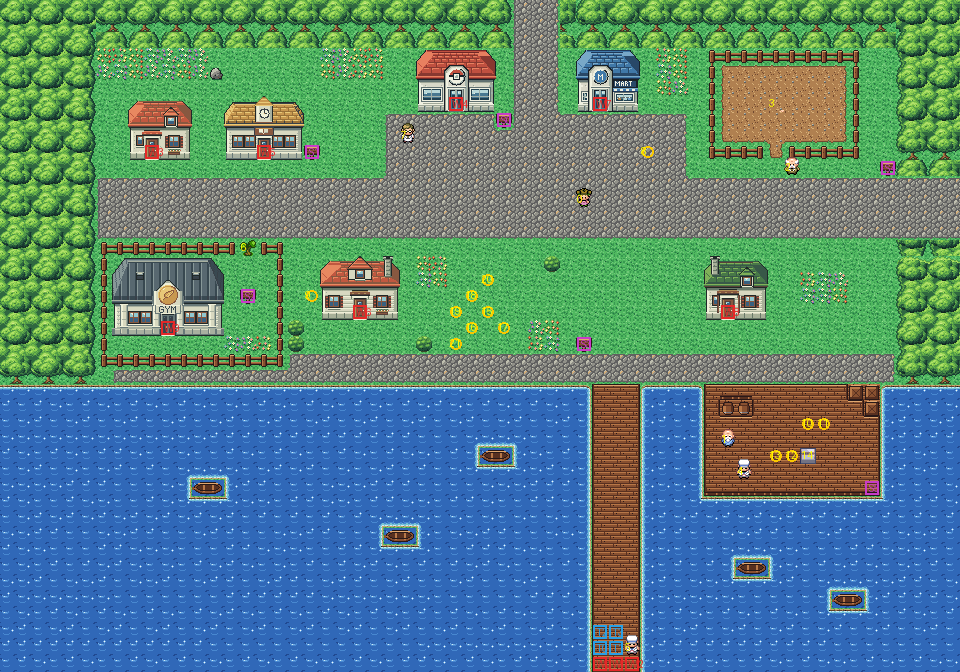

# Vermilion City after its concept

The harbour city, rebuilt from the kit (`../kit`). The concept is this folder's own: `draw_plan.py` draws the block
plan (`plan_stage1.txt`) from shapes and says why things are where they are.

The town is 60×42 blocks (old Vermilion was 71×78), and its joins stay where its neighbours meet it: Route 6's road
meets the top at columns 32–34, and Route 11's the right edge at rows 11–14. It has:
- **the north plaza**, where Route 6's road comes in. The Pokémon Center and the Poké Mart stand either side of it,
  with the city sign and Oak's aide. West of it are the Pokémon Fan Club (Viridian's Trainer School) and a small
  house; east of it the empty lot, fenced, where the old man's Machop stamps the ground flat for a house;
- **the main street**, east along the town to Route 11, with the Snorlax notice by its end;
- **south of the street**: the Gym (Viridian's: in FireRed every Gym looks the same outside) in its fenced yard,
  closed by the tree to cut in the yard's gate; a family house; the little park where the Friends camp (round 30,19,
  as before); a house by the quay;
- **the harbour**: the promenade along the water, the long pier south to the S.S. Anne's gangway, the east quay with
  its crates and barrels where the old sailor and his mate, Officer Jenny and the Squirtles are, and boats in the
  water. The ferry sailor stands at the pier's end with his ticket check before him, as on the old map (relative to
  the gangway). The gangway's blocks warp you onto the ship as you step on them (`MB_DEEP_SOUTH_WARP`). The water is
  the kit's pond: it can be surfed and fished, as Vermilion's could.

Every warp keeps its number and the people keep their order. The heal spot moved with the Center (28,7,
`src/data/heal_locations.json`); the ships land on the pier (off the S.S. Anne on its gangway, the Seagallop past the ticket
check, the S.S. Aqua from Olivine a little further up: KR-41); and old Vermilion's hand-made seam was removed from `kanto_connection_seam.c`. The
pieces are the kit's, the Gym and the Fan Club in Viridian's buildings' palette (bank 7), and the three houses in
its houses' palette (bank 9). The seams are pae's: with Route 6 both maps are the kit's, and old Route 11's colours
fit in banks 10–12.

`make_art.py` checks the town's rules on the map it builds:
- only its three ways out open onto the edges: Route 6's road, Route 11's road and the gangway;
- with the tree standing, the town is everything walkable but the Gym's yard, which the tree opens;
- the pier leads to the gangway past the ticket check;
- every door can be walked into from the block below it, every sign read from it;
- the harbour can be surfed from the town.

Build it from the repository root with `sh project/art/vermilion-concept/build.sh` (or every map with
`sh project/art/build_all.sh`).

Its Town Props (KR-94, `../kit/props.py`): a fountain in the park between the houses (its water animated), a bench and two flower tubs round it, and four benches and two bins along the harbour, looking out to sea (274 of its 384 tiles then).

Its harbour (KR-95, `../kit/harbour.py`, Kanto Harbour Textures v0.1): the square before the Center and the Mart and the fountain's square between the houses are fan setts, a band of them outlining the street's pavement north and south; the main street is the kit's asphalt with its pavements, running on under the trees in the west and turning into Route 11's cobble in its last column in the east (the kit's pavement- and asphalt-to-cobble pieces); the promenade is quay flags with the coping, the quay wall standing in the water along it and round the pier and the dock, with bollards, a lifebuoy, a drain, rope, a mooring ring and a ladder. 307 of its 384 tiles.
