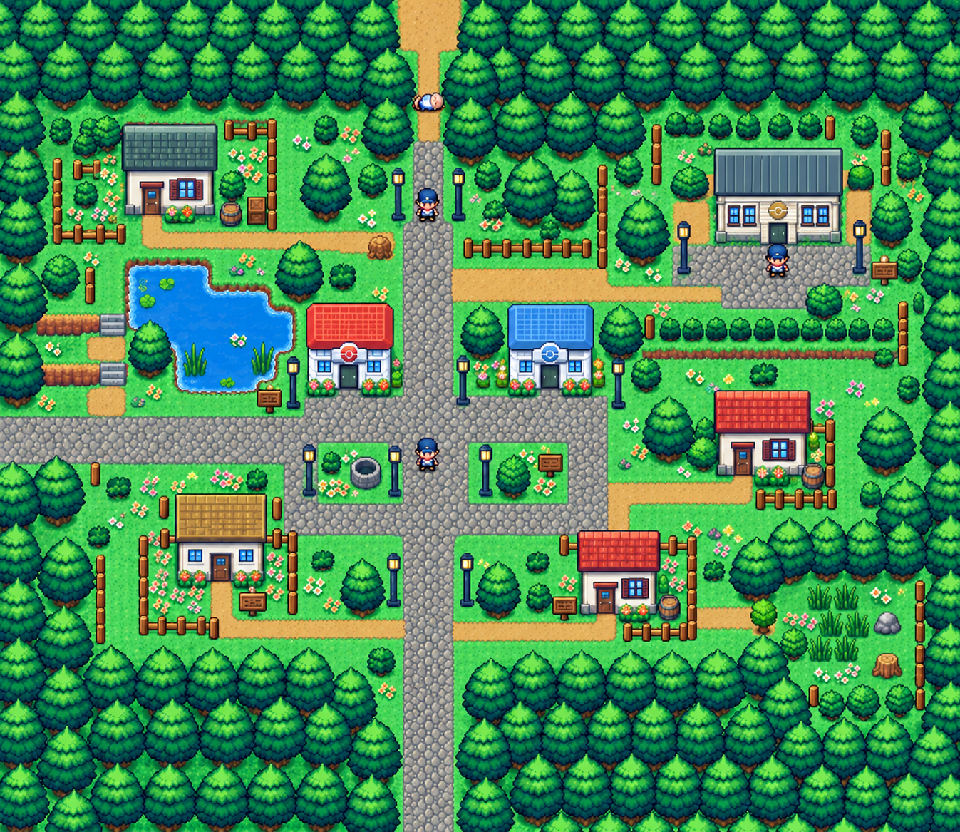
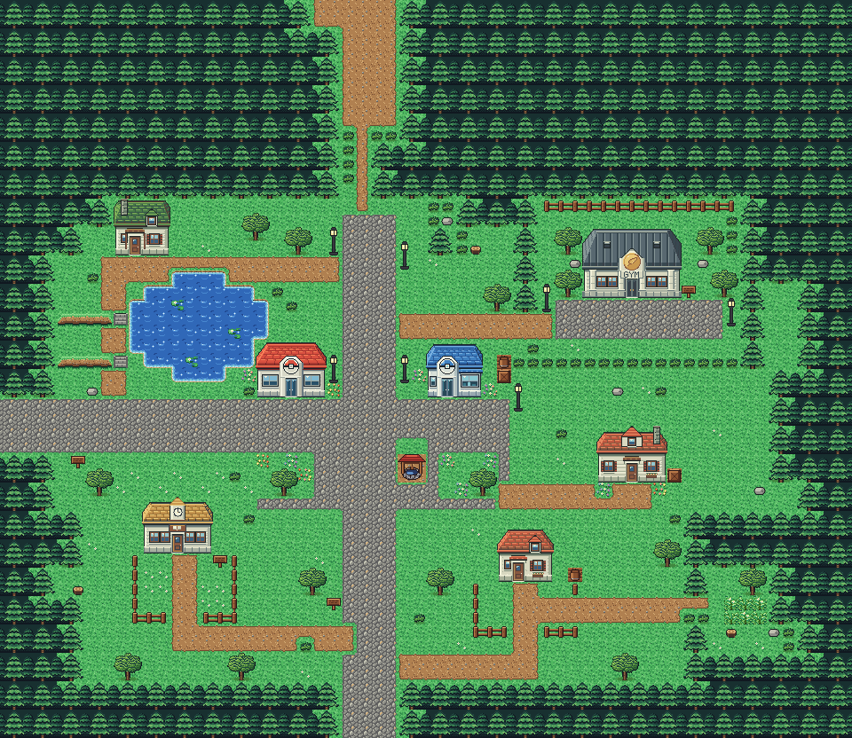
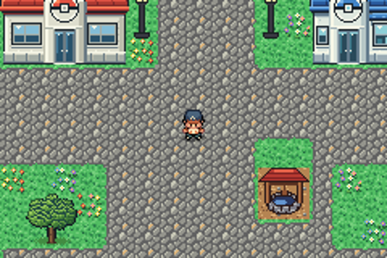
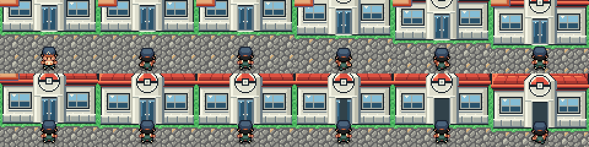
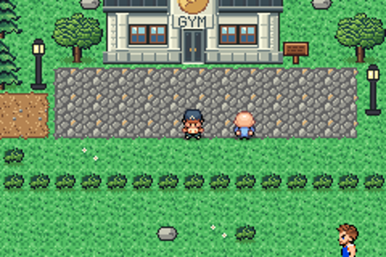
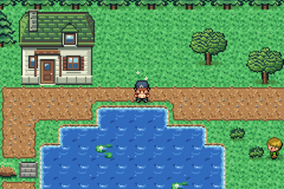
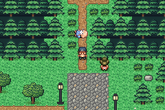
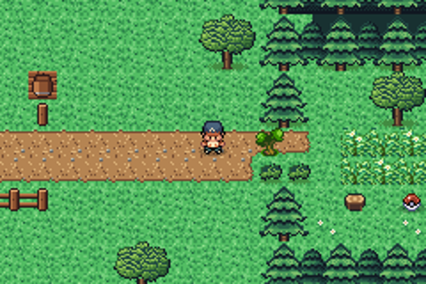

# Viridian City after the concept

The town after Route 1. `concept.png`, `plan_stage1.txt` and the buildings were made with another AI from a brief in
two stages: a concept and block plan, then native pixel packs for each building (`buildings/`, and the Pokémon
Center and the Poké Mart in `../kit/buildings/`, which every town shares). This folder builds the town from the kit
(`../kit`) and those buildings.

The town is 60×52 blocks (it was 56×50). Its exits stay where they met its neighbours (see `../WORLD.md`): Route 2's
path meets the top at columns 22–27, Route 22's road the left edge at rows 28–31, Route 1's road the bottom at
columns 24–27. It has:
- a square with the Pokémon Center and the Poké Mart, lamps, flowers and a well;
- the Gym, set apart in the northeastern trees behind its stone court, locked until late in the game;
- a pond with lily pads and ledges in the west, with steps back up;
- the Trainer School with its fenced garden, and three houses (the family's on the eastern lane is the one you can
  enter; the gardener's and the pond keeper's are locked);
- the old man lying across the one-block road north, until you bring Oak's parcel;
- a hidden grove in the southeast behind a tree to cut, with a Potion in it.

## From the plan to the map

`make_art.py` reads the plan and makes it something the kit can build (`fit`):
- the forest is drawn in 2×2-block trees on an even grid: where the plan has a 2×2 cell partly forest, it's all
  forest if the rest is lawn, else its forest blocks become bushes (so the old man's road stays one block wide and
  the grove stays closed);
- round trees and the well are 2×2 and lamps 1×2: the plan's one-block ones grow where there's lawn;
- lamps and signs the plan stood in the roads or on the Gym's court stand on the lawn beside them;
- lily pads and reeds only grow in open water;
- the road north widens at the edge to meet all of Route 2's path.

Then it checks the town still works: the old man alone closes the road north, the tree alone the grove, every door
is reachable and the exits are open.

## The buildings

Native pixel packs, each with its picture, a 48×32 strip of three door frames (the door and the block above it) and
its footprint and door (`buildings.py` in the kit loads them):

| Building | Blocks | Palette | Door |
|---|---|---|---|
| Pokémon Center | 5×4 | kit bank 5 | sliding, drawn frames |
| Poké Mart | 4×4 | kit bank 6 | sliding, drawn frames |
| Gym | 7×5 | Viridian bank 7 | drawn frames |
| Trainer School | 5×4 | Viridian bank 7 | drawn frames |
| Family house | 5×4 | Viridian bank 9 | drawn frames |
| Gardener's house, pond keeper's cottage | 4×4 | Viridian bank 9 | locked (no inside yet) |

The doors animate with `pae door add --frames` (tall doors: the game's large doors, two blocks high). The tree to cut
is still FireRed's: the pack's tree is one frame, and the game's cuts in four.

## Rebuild

From the repository root: `sh project/art/build_all.sh` rebuilds every map made from the kit.
`sh project/art/viridian-concept/build.sh` alone runs `make_art.py`, `pae tileset new` (the first time),
`pae map geometry` (60×52), `pae tileset build`, `pae map paint`, `pae map connect` (Route 2, Route 22, Route 1),
`pae seam build` (without Route 22: see `../WORLD.md`), `pae door add` and `pae map place` for the events.

The scripts with coordinates (`data/maps/ViridianCity_Frlg/scripts.inc`) put the old man across the road at (25,11)
and by it at (24,13); one trigger each takes their place (the road is one block wide now). The Gym's lock steps you
back down its court. The heal spot is in front of the Center (20,28), and the Friends story's group lands on the south
road, where Giratina drops them (its anchor in `src/data/friends_scene_locations.h`).

## In game

Replay tests: `viridian enter the pokemon center`, `viridian enter the mart`, `viridian enter the school`,
`viridian enter the house`, `viridian gym doors locked`, `viridian old man blocks the road`,
`viridian old man by the road`, `viridian locked house`, `viridian north to route 2`, `route 2 looks at viridian`,
`viridian looks at route 1`, `route 1 north to viridian`.
