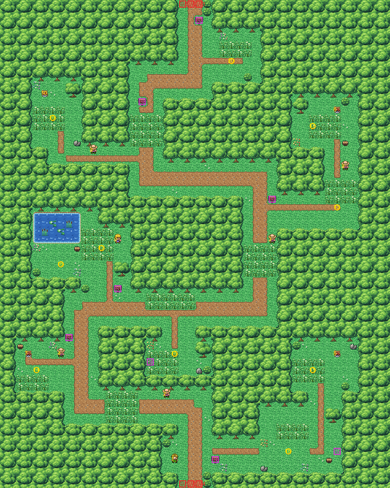

# Viridian Forest after the concept

The forest between Route 2's two gates. The plan was made with another AI from a brief, from the kit's art only:
a concept and block plan (`concept.png`, `plan_stage1.txt`, `map_events.json`: Viridian Forest Concept v0.1). This
folder builds the forest from the kit (`../kit`) and six exit blocks of its own.

The forest is 48×60 blocks (it was 74×79). It has:
- **the exits**, three blocks wide in the middle of the bottom and top rows (columns 22–24). The south one is
  entered walking south (`MB_SOUTH_ARROW_WARP`), the north one by walking onto it (`MB_NON_ANIMATED_DOOR`), as the
  old forest's were, and each keeps its warp numbers (the gates warp to 0 and 2). Those six blocks are the forest's
  own tileset: the kit's lawn and dirt path with the warp behaviours;
- **the trail**, a single winding walk from the south exit to the north one. Three bands of tall grass cross it
  that can't be walked round (columns 13–16 rows 48–51, columns 30–33 rows 30–33, columns 16–19 rows 14–17), and
  two trainers look across it: Rick (20,48, south, 3 blocks) and Doug (33,29, west, 3 blocks);
- **three item branches**, each with its trainer: Sammy (7,43) and the Potion on the west one, Anthony (42,20) and
  the Antidote on the north-east one, Charlie (11,18) and the second Potion on the north-west one. The Poké Ball is
  at the end of the south-east branch, by the glade;
- **the pond** (columns 4–9, rows 26–29) with a lawn beside it, the south-east glade, and ten Pokémon about the
  forest, each with walkable ground all round it (3×3). The pond is the kit's, so it can be surfed and fished later,
  like Route 1's; it leads nowhere, so the concept's "no Surf route" holds;
- the five trainer tips and the exit sign, each read from the block below it, and the two hidden items (the
  Antidote in the glade, the Potion in the tall grass west of the trail).

The old forest's layout had block fixes of its own (`blockdata_overrides` in `layouts.json`); the map's
`firered_geometry` inherits what it doesn't set, so it clears them (`"blockdata_overrides": null`): they point at the
old block file. pae's `map geometry` doesn't do that yet.

The kit's forest is drawn in whole 2×2 cells, so the one-block strip the concept leaves east of each exit
(column 25) is bushes here. The forest needs three inside corners the kit didn't have (`kit.FOREST_CORNERS`), so
adding it rebuilt every map made from the kit.

`make_art.py` checks the concept's rules on the map it builds: the forest is whole cells; nothing but the exits
opens onto the edges; everything walkable is one area, reached from the south exit with every trainer, person and
item ball in place; every sign can be read and every item reached; none of the three bands of tall grass and
neither trainer on the trail can be walked round.

Build it from the repository root with `sh project/art/viridianforest-concept/build.sh` (or every map with
`sh project/art/build_all.sh`).
